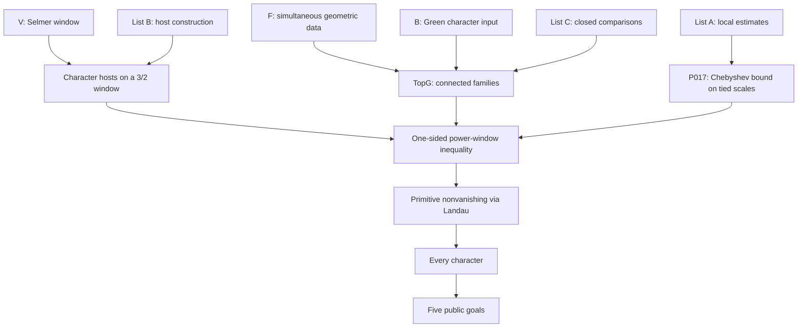
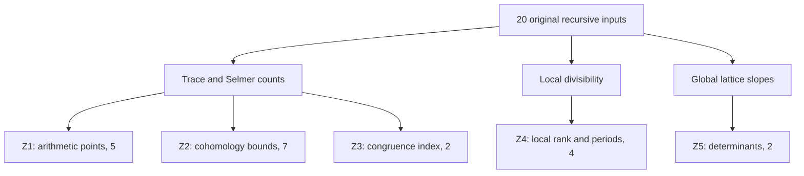
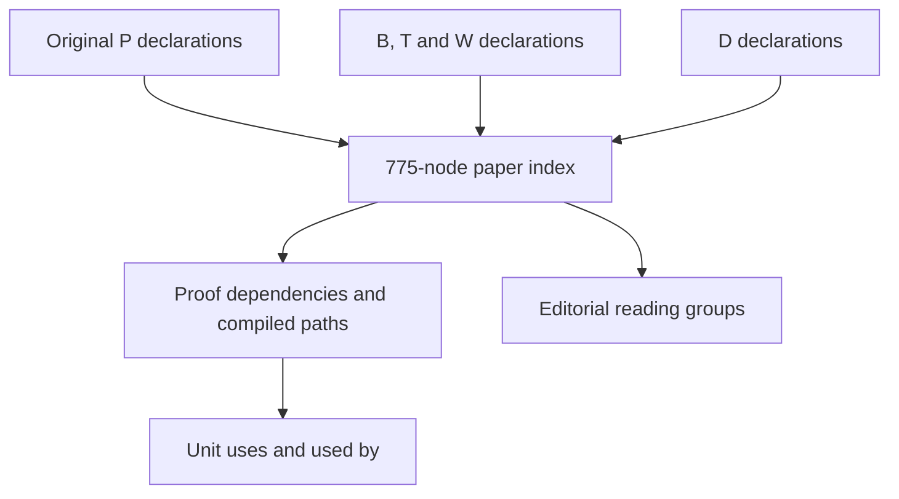

# Map of the argument

AI-written, AI cross-reviewed; no human sign-off; not a claim that RH is proved

Trace the two open inputs in the [Selmer window map](pillars/V.md) and the [definite-side witness map](pillars/F.md). Each table gives the assumptions, source calls and first steps to challenge.

## 1. Five goals and the common window

The five exported statements reduce through the common every-character assertion. The written argument uses a one-sided Chebyshev bound on arbitrarily distant intervals of fixed power length. For a zero with real part greater than one half, the exponent can be chosen strictly below that real part. The Landau argument then excludes the corresponding pole. The arithmetic and geometric inputs below supply the hypotheses of this conditional deduction.

Arrows in this diagram run from an input to the deduction it supports. The last step includes passage to the inducing primitive character and the functional equation. The five targets are the Mathlib zeta statement, the explicit zeta zero-line statement, Dirichlet nonvanishing on the right half-plane, and the open-strip zero-line statements for all and for primitive characters. [P001](units/P001.md) · [P002](units/P002.md) · [P003](units/P003.md) · [P004](units/P004.md) · [P005](units/P005.md). [Exact signatures and exceptions](sources/lean-goals.md)

| Input | What the implication assumes | Dominated core lines at the supplying theorem |
|---|---|---:|
| V | A common Selmer length budget on windows for each primitive character (exponent 401). [P013](units/P013.md) | 886,201 |
| F | One inhabitant of the HypsAlt record for closed LinkN and the definite-side condition. [T02](units/T02.md) | 3,679,692 |
| B | Green’s character-theoretic input for finite general linear groups. [D575](units/D575.md) | 280 |

The Selmer budget concerns a localization kernel. The comparison also needs LinkN on the chosen geometric data and the same family index. After the local and slope estimates, P017 bounds the weighted prime sum by $x^{1/2+(e_D+e_L+7)\varepsilon}$. The chosen exponents give $1/2+9\varepsilon$. [Geometric estimate](units/D427.md) · [Slope bound](units/P021.md) · [Window inequality](units/P017.md) · [Landau theorem](units/P022.md)

The following lists are the remaining formal premises in the review of paper v3, §6.2. The single-letter input B and the list labelled B are separate entries. Paper v4 writes out list A and states the conditional deduction at two locations. [Conditional unit and table](units/V4-COND.md) · [Edition-specific review](reviews/R23_review.md)

| List | What it supplies | Components in the v3 review |
|---|---|---|
| A | The lattice and error estimates for [P017](units/P017.md). | [D547](units/D547.md), [D548](units/D548.md), [D549](units/D549.md), [D562](units/D562.md), [D567](units/D567.md), [D014](units/D014.md), [D550](units/D550.md), the character balance identity, the Lipschitz weight estimate and the thick-place rewrite. |
| B | Combining the Selmer window with a host, as required by [B07](units/B07.md). | The prime pair and its share and existence, the character field, the bounded twist and its field/pair identifications inside [D510](units/D510.md), then [D511](units/D511.md), [D513](units/D513.md) and [D515](lookup/declarations-u-z.md#decl-ab683d968e5f4960). |
| C | The closed geometric and arithmetic comparisons assembled in [B05](units/B05.md). | [D483](lookup/declarations-g-l.md#decl-35b78903064984ec), [D479](units/D479.md), [D481](units/D481.md), [D480](lookup/declarations-g-l.md#decl-599502f5f08a861f), [D482](lookup/declarations-g-l.md#decl-dc522f028bf854f2), [B06](units/B06.md), [D484](units/D484.md), [D485](lookup/declarations-g-l.md#decl-4da934d5d19d20b8), [D486](units/D486.md), [D489](lookup/declarations-g-l.md#decl-208e3e2ec1580190), including the D516–D518 subentries of B06, plus the small-level rank equality, decay selection and final shape-to-goal assembly. |

## 2. The original twenty recursive inputs

The blueprint ledger grouped twenty recursive inputs, each with one or more exact Lean entry declarations. The paper identified twenty-nine entry declarations in total. Its predecessor column gives the upper paper declaration and the length of each checked proof path, in the same order as the entry IDs. Each specialist link opens the current atlas unit for that original assignment. [Ledger transcription with source hashes](data/map_inputs.json) · [Blueprint assignment crosswalk](data/blueprint_groups.json)

This diagram groups obligations by subject. Z2.K3 had already been discharged when the historical ledger opened. The ledger records local completion under the stated premises for fourteen of these twenty groups. These historical dispositions and current unit grades have different scopes.

| Original input | Mathematical question | Entry declarations | From / proof hops | Specialist units |
|---|---|---|---|---|
| Z1.1 | Markings and propagation of automorphy | [P024](units/P024.md) | [P013](units/P013.md) / 6 | [Z1.1.01](units/Z1.1.01.md), [Z1.1.02](units/Z1.1.02.md), [Z1.1.03](units/Z1.1.03.md), [Z1.1.04](units/Z1.1.04.md), [Z1.1.05](units/Z1.1.05.md), [Z1.1.06](units/Z1.1.06.md), [Z1.1.07](units/Z1.1.07.md) |
| Z1.2 | Adjoint rigidity under ordinary hypotheses | [P025](units/P025.md) | [P013](units/P013.md) / 9 | [Z1.2](units/Z1.2.md) |
| Z1.3 | Euler systems and the local condition | [P026](units/P026.md) | [P013](units/P013.md) / 9 | [Z1.3.01](units/Z1.3.01.md), [Z1.3.02](units/Z1.3.02.md), [Z1.3.03](units/Z1.3.03.md), [Z1.3.04](units/Z1.3.04.md), [Z1.3.05](units/Z1.3.05.md), [Z1.3.06](units/Z1.3.06.md), [Z1.3.07](units/Z1.3.07.md), [Z1.3.08](units/Z1.3.08.md) |
| Z1.4 | Graded cotangent length | [P027](units/P027.md), [P028](units/P028.md) | [P013](units/P013.md) / 7, 7 | [Z1.4](units/Z1.4.md) |
| Z1.5 | Counting systems of eigenvalues | [P029](units/P029.md), [P030](units/P030.md) | [P013](units/P013.md) / 9, 9 | [Z1.5.01](units/Z1.5.01.md), [Z1.5.02](units/Z1.5.02.md), [Z1.5.03](units/Z1.5.03.md), [Z1.5.04](units/Z1.5.04.md), [Z1.5.05](units/Z1.5.05.md), [Z1.5.06](units/Z1.5.06.md), [Z1.5.07](units/Z1.5.07.md) |
| Z2.K1 | Descent of the localization kernel | [P031](units/P031.md) | [P013](units/P013.md) / 13 | [Z2.K1](units/Z2.K1.md) |
| Z2.K2 | Integral cycles and residue-field evaluation | [P032](units/P032.md), [P033](units/P033.md) | [P013](units/P013.md) / 9, 9 | [Z2.K2](units/Z2.K2.md) |
| Z2.K4 | Stable odd homology and torsion | [P034](units/P034.md), [P035](units/P035.md) | [P013](units/P013.md) / 8, 10 | [Z2.K4](units/Z2.K4.md) |
| Z2.K5 | Counting equivariant characters | [P036](units/P036.md) | [P013](units/P013.md) / 9 | [Z2.K5](units/Z2.K5.md) |
| Z2.K6 | Uniform layer bounds and global kernel | [P037](units/P037.md) | [P013](units/P013.md) / 9 | [Z2.K6](units/Z2.K6.md) |
| Z2.K7 | Torsion in integral homology | [P038](units/P038.md), [P039](units/P039.md) | [P013](units/P013.md) / 11, 10 | [Z2.K7](units/Z2.K7.md) |
| Z2.K8 | Finite duality and lengths | [P040](units/P040.md) | [P013](units/P013.md) / 11 | [Z2.K8](units/Z2.K8.md) |
| Z3.1 | Normalized matrix algebra | [P041](units/P041.md), [P042](units/P042.md) | [P012](units/P012.md) / 14, 17 | [Z3.1](units/Z3.1.md) |
| Z3.2 | Local conditions and a lattice index | [P043](units/P043.md), [P044](units/P044.md) | [P012](units/P012.md) / 12, 11 | [Z3.2](units/Z3.2.md) |
| Z4.1 | Normalized Hecke action on jets | [P045](units/P045.md) | [P015](units/P015.md) / 8 | [Z4.1](units/Z4.1.md) |
| Z4.2 | Comparison and admissibility at a site | [P046](units/P046.md) | [P012](units/P012.md) / 20 | [Z42-SITES](units/Z42-SITES.md), [Z4.2.02](units/Z4.2.02.md), [Z4.2.04](units/Z4.2.04.md), [Z42-FRAMES](units/Z42-FRAMES.md), [Z42-KERNEL](units/Z42-KERNEL.md), [Z4.2.13](units/Z4.2.13.md) |
| Z4.3 | Off-level kernel valuations | [P047](units/P047.md) | [P015](units/P015.md) / 8 | [Z4.3](units/Z4.3.md) |
| Z4.4 | Twisted periods on a chosen chain | [P048](units/P048.md) | [P012](units/P012.md) / 10 | [Z4.4](units/Z4.4.md) |
| Z5.1 | Gram determinants and lattice index | [P049](units/P049.md), [P050](units/P050.md) | [P012](units/P012.md) / 9, 9 | [Z5.1](units/Z5.1.md) |
| Z5.2 | Height of the evaluation-dual lattice | [P051](lookup/declarations-a-f.md#decl-317f8646b1f582ed), [P052](lookup/declarations-a-f.md#decl-b3fac6b2114d486b) | [P015](units/P015.md) / 11, 12 | [Z5.2](units/Z5.2.md) |

## 3. Inside the 775-node graph

The 140 P entries are the original paper skeleton. A first expansion adds the 10 B, 26 T and 16 W entries. The D register adds 583 further entries. The graph retains all 775 identities, including entries attached to another reading unit. The namespace lookup also covers blueprint chart suppliers, crosswalk support and starter packets. [775-node graph and paths](data/graph.json) · [Unit projection](data/unit_graph.json) · [Declaration lookup](lookup/declarations.md)

Of the 1,410 stored relations, 239 give direct compiled calls, 419 record compiled paths, and 123 record identified skeleton dependencies. The other 629 group entries for reading. Multiple records can describe one pair. The separate unit survey includes longer paths between statement heads, with each hop checked against the compiled value. Its paths and object hashes are available in the [compiled-value evidence](data/unit_value_routes.json).

For a concrete route, P023 reaches P022 through `Deduction.lemmaL`. The graph gives the intermediate Lean name. The unit page gives the hypotheses, proof location and review level. Dominated lines measure a different property of a larger graph that also follows types and constructors. [P023](units/P023.md) · [P022](units/P022.md) · [Dominator conventions](data/pins.json)
