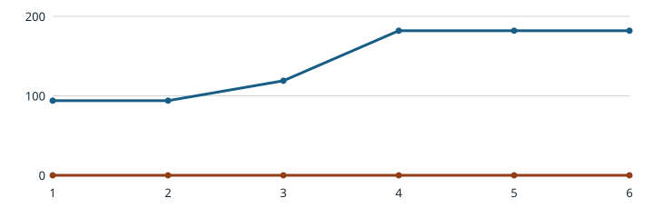

# Writing and reading progress

AI-written, AI cross-reviewed; no human sign-off; not a claim that RH is proved

Of 217 units, **55 have a Full argument under stated inputs**, **127 have an outline**, and **35 give the statement only**.

The notes contain **739 active proof steps**. **6** have a current step-specific AI review. **0** have a current human check.

## Source lines cited by active steps

A cited line locates a written step in the pinned Lean source and by itself establishes neither a line-by-line check nor a complete proof.

The steps cite **13,015 distinct physical lines**. Of these, 12,584 are in the dependency graph of the all-character statement `allChi`. The original 855 indexed files contain 5,862 of the cited lines. The remaining 7,153 appear in other files at the same Lean commit.

| Evidence or exposition | Distinct cited lines / 17,374,215 full-source lines | Within 9,567,045 core lines | Within 101,765 lines of the original file sample |
|---|---:|---:|---:|
| Any written unit | 13,015 (0.0749%) | 12,584 (0.1315%) | 5,862 (5.7603%) |
| Full | 5,863 (0.0337%) | 5,853 (0.0612%) | 3,177 (3.1219%) |
| Outlined | 7,928 (0.0456%) | 7,507 (0.0785%) | 3,144 (3.0895%) |
| Current AI review of the specific step | 60 (0.0003%) | 60 (0.0006%) | 51 (0.0501%) |
| Current AI review of the containing prose | 1,686 (0.0097%) | 1,686 (0.0176%) | 1,060 (1.0416%) |
| Current human check of the specific step | 0 (0.0000%) | 0 (0.0000%) | 0 (0.0000%) |

Full and Outlined notes cite 776 of the same physical lines. The first row takes their union. The two AI rows distinguish a verdict on the named step from a review of its enclosing prose. A whole-note review does not supply a verdict on a step added later. Each evidence row counts its own union.

## Position in the declaration index

This table shows where a line sits in the index. It gives no evidence that the line was explained or read.

| Writing status of nearest indexed statement | Core lines at this index position |
|---|---:|
| Full | 31,564 (0.3299%) |
| Outlined | 8,324,895 (87.0164%) |
| Statement only | 1,210,586 (12.6537%) |
| Of Full, also at evidence level L2 | 5,202 (0.0544%) |

Each line belongs to the nearest indexed unit statement at or above it in the dominator tree. 28 statement declarations have more than one primary unit. For a shared statement, the earliest unit ID in ordinary character order owns the position. This deterministic tie-break ignores grades. The Full-and-L2 row is part of Full.

For example, P034 and Z2.K4 share the head `bOdd_zk`. The tie rule assigns its 23,135 lines to P034. Choosing the other card would move those positions between the two writing-status rows without changing a single note.

A core line is one unit of weight for a physical source line of a reachable core declaration in the graph rooted at `allChi` (9,567,045 in total). A literature node is a declaration marked as a stopping point by the extraction’s name or module rule, so the graph does not follow its proof or establish its relation to any publication.

The complete pinned source contains 17,374,215 physical lines in 175,187 Lean files. This is the count of newline characters in every `.lean` file under `lean/src/` in the pinned archive. Every nonempty file ends with a newline.

The V and F supplier subtrees are disjoint. They contain 886,201 and 3,679,692 core lines, respectively, or 4,565,893 together. The closed character statement P010 contains a further 2,137,850 core lines outside the subtree of its row implication P011. These are source-graph locations. The atlas contains no human-readable derivation of either supplier.

[Per-field citation unions](progress/by-field.md) · [Counting rules](progress/README.md) · [Reproduce the index assignment](progress/index_position.json)

## Units with evidence at each stage

The first two stages concern the unit’s statement. Written includes Full arguments and Outlined derivations. A human check of a whole unit requires a positive current record for every active step and the statement comparison.

| Primary field | Units | 1 · Pinned | 2 · Compared | 3 · Written | 4 · Steps | 5 · AI review | 6 · Human |
|---|---:|---:|---:|---:|---:|---:|---:|
| **All** | 217 | 217 | 79 | 182 | 182 | 20 | 0 |
| [analytic](tracks/analytic/README.md) | 35 | 35 | 22 | 31 | 31 | 11 | 0 |
| [arakelov](tracks/arakelov/README.md) | 33 | 33 | 11 | 27 | 27 | 4 | 0 |
| [formal](tracks/formal/README.md) | 10 | 10 | 5 | 10 | 10 | 0 | 0 |
| [galois](tracks/galois/README.md) | 62 | 62 | 14 | 37 | 37 | 2 | 0 |
| [ktheory](tracks/ktheory/README.md) | 11 | 11 | 11 | 11 | 11 | 1 | 0 |
| [local](tracks/local/README.md) | 26 | 26 | 5 | 26 | 26 | 1 | 0 |
| [theta](tracks/theta/README.md) | 40 | 40 | 11 | 40 | 40 | 1 | 0 |

## Checks on individual steps

| Primary field | Active steps | AI-reviewed steps | Human-checked steps | Steps with two independent readers | Units with two independent readers | Disputed |
|---|---:|---:|---:|---:|---:|---:|
| **All** | 739 | 6 | 0 | 0 | 0 | 0 |
| [analytic](tracks/analytic/README.md) | 116 | 6 | 0 | 0 | 0 | 0 |
| [arakelov](tracks/arakelov/README.md) | 106 | 0 | 0 | 0 | 0 | 0 |
| [formal](tracks/formal/README.md) | 35 | 0 | 0 | 0 | 0 | 0 |
| [galois](tracks/galois/README.md) | 163 | 0 | 0 | 0 | 0 | 0 |
| [ktheory](tracks/ktheory/README.md) | 52 | 0 | 0 | 0 | 0 | 0 |
| [local](tracks/local/README.md) | 102 | 0 | 0 | 0 | 0 | 0 |
| [theta](tracks/theta/README.md) | 165 | 0 | 0 | 0 | 0 | 0 |

Among 24 units at L2 and 20 at stage 5, L2 without stage 5: [D014](units/D014.md), [P014](units/P014.md), [Z1.3.06](units/Z1.3.06.md), [Z1.3.07](units/Z1.3.07.md), [Z4.2.04](units/Z4.2.04.md). Stage 5 without L2: [D550](units/D550.md).

D014’s L2 concerns one written proof. Its separate companion note has no current whole-note review.

D550’s current individual checkpoints have scoped AI reviews. The light check does not approve its entire argument at L2.

Stage 2 uses a recorded comparison of the named statement, including earlier comparisons of the same transcription. Stage 5 accepts an edition-matched review of the written argument or a review of every active step. An earlier unit-level review remains unit-level. A proof can have a review before it has a step checklist.

## Recorded history

Blue shows units with written arguments. Rust shows units with a complete human check for the recorded edition. The horizontal axis numbers the snapshots. The source-line column uses the checklist available in each round.

| Snapshot | Date (UTC) | Units | Compared | Written | With steps | AI review | Human | Distinct lines cited |
|---|---:|---:|---:|---:|---:|---:|---:|---:|
| 1 · Round 1 | 2026-11-24 | 213 | 71 | 94 | 0 | 20 | 0 | 0 |
| 2 · Round 2 | 2026-11-24 | 213 | 71 | 94 | 0 | 20 | 0 | 0 |
| 3 · Round 3 | 2026-11-25 | 214 | 71 | 119 | 0 | 20 | 0 | 0 |
| 4 · Round 4 | 2026-11-25 | 217 | 78 | 182 | 182 | 26 | 0 | 12,936 |
| 5 · Round 5 | 2026-11-25 | 217 | 78 | 182 | 182 | 26 | 0 | 12,936 |
| 6 · Round 6 | 2026-11-25 | 217 | 79 | 182 | 182 | 20 | 0 | 13,015 |

The early records summarize editorial editions predating the public release. Their identifiers are digests of the recorded counts. The first three editions contain prose but predate step checklists. Zero cited lines there means zero recorded step citations.

Round 6 counted only reviews covering the current argument, reducing the unit count from 26 to 20, and set aside earlier verdicts on D014 S7 and D548 S2–S3, reducing the number of steps with a specific review from 9 to 6.

[Machine-readable history](progress/history.jsonl) · [Dashboard](dashboard/README.md) · [Submit a human check](signoffs/README.md)
