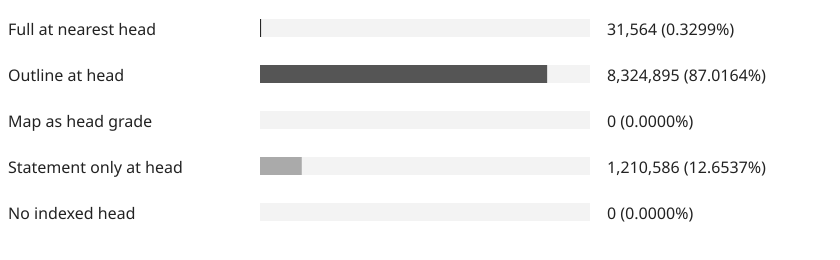

# Scope, coverage and verification tasks

AI-written, AI cross-reviewed; no human sign-off; not a claim that RH is proved

## Coverage map

Reachable core at the literature frontier of the pinned allChi graph; the complete pinned source has 17,374,215 physical lines.

Start with each complete residual row of the existing nearest-indexed-head partition. Assign the row to its nearest indicated subtree root. Outside those subtrees assign only residuals owned directly by the listed outer heads to assembly. All remaining head regions go to other. A large residual at a top-level head includes internal dependencies and is not a measure of the length of its wrapper.

| Block | Role | Lean entries | Core lines | Written locations | Exposition levels | AI review | Human checks |
|---|---|---|---|---|---|---|---|
| Landau window criterion | Exclude zeros using a one-sided bound on long intervals. | `Deduction.landau_window` · `UpperTheory.Comparison₂.formB` · `Formalism.HC.zeroFreeOn_of_tiedWin_cyc` | 2,115 | Full under the stated window hypothesis. · [Paper §C.4, pp. 96–100 (5 pp.)](../editions/v0.1.0/paper_v8.pdf#page=96) | Full under stated inputs · Full at nearest head 2,115 | P022: R20 v0, full local derivation accepted. | 0 |
| Window inequality and list A | Use ten local implications to bound a weighted prime sum. | `UpperTheory.Comparison₂.level_gm_le_on_family_scales` · `UpperTheory.Comparison₂.core_gm` | 3,365 | Window inequality and local analytic arguments. · [Paper §5.1, pp. 25–35 (11 pp.)](../editions/v0.1.0/paper_v8.pdf#page=25) | P017 has a Full argument under list A and the stated lattice inputs. List A has mixed grades: A8 and A10 (D561) are outlines. · Full at nearest head 1,924 · Outline at head 1,431 · Statement only at head 10 | P017: R20 v0, statement exact; no review of the whole A block. | 0 |
| Host construction and list B | Choose auxiliary primes and fields on which the estimates can be compared. | `UpperTheory.Top.supplyChi` · `UpperTheory.Top.zero_free_all_of_green_v_win` | 31,622 | Outline of the host supply; individual local deductions are given. · [Paper pp. 40–44 (5 pp.)](../editions/v0.1.0/paper_v8.pdf#page=40) | Outline · Full at nearest head 11,065 · Outline at head 323 · Statement only at head 20,234 | B07: R21 v1, exact statement comparison. | 0 |
| Geometric comparison and list C | Place geometric and arithmetic estimates on one compatible family. | `UpperTheory.Top.shape_closed_link_n_of_green` · `GlobalTheory.Top.closed_family_admissible_twist_link_alt` | 146,214 | Outline of the joined comparison under list C. · [Paper pp. 43–44 (2 pp.)](../editions/v0.1.0/paper_v8.pdf#page=43) | Outline · Full at nearest head 72 · Outline at head 129,507 · Statement only at head 16,635 | B05: no whole-block verdict. | 0 |
| Selmer supplier V and its first two levels | Supply a common interval controlling weighted lengths of local kernels. | `UpperTheory.One.vwin_of_row` · `UpperTheory.One.Join.automorphic_window_of_inputs` | 886,201 | Map of two supplier levels; full derivation not written. · [Paper §5.4, pp. 45–49 (5 pp.)](../editions/v0.1.0/paper_v8.pdf#page=45) · [Two-level supplier map (`pillars/V.md`)](../pillars/V.md) | Top-level map only · Full at nearest head 2,065 · Outline at head 653,247 · Statement only at head 230,889 | P013: R20 v0, exact statement comparison; no full V verdict. | 0 |
| Definite-side supplier F and its first two levels | Supply a compatible family class and selection on the definite side. | `UpperTheory.Lit.nonempty_hyps_definite_side_of_closed_bound` · `GlobalTheory.Fc.S0.StageU.hypotheses_nonempty_of_unramified_exponents_alt` | 3,679,692 | Map of two supplier levels; full derivation not written. · [Paper §5.5, pp. 49–50 (2 pp.)](../editions/v0.1.0/paper_v8.pdf#page=49) · [Two-level supplier map (`pillars/F.md`)](../pillars/F.md) | Top-level map only · Full at nearest head 13,564 · Outline at head 3,460,914 · Statement only at head 205,214 | T02: R21 v1, exact statement comparison; no full F verdict. | 0 |
| Top-level assembly and the public conclusions | Reach all characters and zeta. Most of this row is the internal dependency residual of P010 and P012. | `allChi` · `UpperTheory.FinalTheorems.everyCharacter_of_row` · `LFunction_ne_zero_of_half_lt_re` | 2,586,981 | Conditional assembly and goal comparisons; the dependencies still need their own checks. · [Paper pp. 50–53 (4 pp.)](../editions/v0.1.0/paper_v8.pdf#page=50) · [Paper pp. 90–91 (2 pp.)](../editions/v0.1.0/paper_v8.pdf#page=90) | Outline · Full at nearest head 126 · Outline at head 2,586,855 | P011 and P003: R20 v0, statement comparisons only. | 0 |
| Other index positions | Collect all remaining local and shared work, including representation and comparison inputs. | `UpperTheory.Gal.Int.Geo.geoOne_holds` · `SelfIntersectionVolumeEstimates.topCovolSlim2_use_alt_alt` | 2,230,855 | Mixed local records. No block-wide derivation is written. · [Paper pp. 72–73 (2 pp.)](../editions/v0.1.0/paper_v8.pdf#page=72) · [Paper p. 80 (1 p.)](../editions/v0.1.0/paper_v8.pdf#page=80) | Mixed local levels · Full at nearest head 633 · Outline at head 1,492,618 · Statement only at head 737,604 | No verdict for this remainder as a whole. | 0 |
| **Total** | | | **9,567,045** | | | | |

Each core line is assigned to the nearest indexed statement above it. For 0.3299% of lines, that statement has a Full local argument. For 87.0164% it has an outline, and for 12.6537% it has only a statement. These percentages describe the indexed statements. They do not measure written proofs of the lines beneath them. The largest Full contribution, 11,065 lines in the host row, belongs to N415; its two-page argument applies a cited estimate. V and F have top-level maps as block descriptions. Neither has a separate top-level-map grade at an indexed head. The largest named inputs without full written derivations are F (3,679,692 core lines) and V (886,201).

| Active step citations | Core lines | Share |
|---|---:|---:|
| Cited by a Full step | 5,853 | 0.0612% |
| Additional lines cited only by Outline steps | 6,731 | 0.0704% |
| No active step cites this line | 9,554,461 | 99.8685% |

Of 9,567,045 weighted core lines, 5,853 (0.0612%) are cited in Full notes, 6,731 more (0.0704%) only in outlines, and 9,554,461 (99.8685%) have no citation in an active step. A citation locates an assertion; an uncited line may have exposition elsewhere. The physical citation union over the entire source is 13,015, including 12,584 in the core.

Direct citations do not establish a line-by-line proof. The share of the interior with a complete written derivation has not been measured. Of 55 locally Full units, 0 have a recursively closed set of Full prerequisites.

## What a reader can check

Numbers refer to active steps in the current atlas checklist. Statement-only comparisons select zero proof steps. A paper passage and its related checklist can have different editions. To sign, read the identified checklist edition itself. Record a mismatch, missing premise or inconclusive result as readily as a positive check.

### 1. Mathlib’s zeta formulation

**Check.** Compare the zero, the excluded negative even integers and the exception at one with the Lean predicate.

**Inputs.** Use Mathlib’s definition of RiemannHypothesis.

**Background.** Complex numbers and reading quantifiers.

**A positive check establishes.** The printed P001 states Mathlib’s predicate.

**Outside this check.** A statement match supplies no proof of the exported theorem.

[Paper §C, p. 90 (1 p.)](../editions/v0.1.0/paper_v8.pdf#page=90) · 0 of 5 numbered checklist steps · [P001 checklist](../units/P001.check.md).

`riemannHypothesis` · `Main.lean:4–4`

`RiemannHypothesis` · `Mathlib/NumberTheory/LSeries/RiemannZeta.lean:185–186`

### 2. The explicit zeta goal

**Check.** Check the universal complex input, the zeta zero, both exclusions and the real-part conclusion.

**Inputs.** Use the project definition of RiemannZetaZerosOnLine.

**Background.** Complex numbers and reading quantifiers.

**A positive check establishes.** The exclusions and conclusion of P002 match the export.

**Outside this check.** A statement match supplies no proof of the exported theorem.

[Paper §C, p. 90 (1 p.)](../editions/v0.1.0/paper_v8.pdf#page=90) · 0 of 3 numbered checklist steps · [P002 checklist](../units/P002.check.md).

`riemannZeta_eq_zero_re` · `Main.lean:6–6`

`RiemannZetaZerosOnLine` · `Statements.lean:3–4`

### 3. Right-half-plane nonvanishing

**Check.** Check the strict half-plane and the disjunction allowing all cases except the principal character at one.

**Inputs.** Allow every nonzero modulus and every Dirichlet character.

**Background.** Complex numbers and reading quantifiers.

**A positive check establishes.** P003 preserves the exception and the full range of characters.

**Outside this check.** A statement match supplies no proof of the exported theorem.

[Paper §C, p. 91 (1 p.)](../editions/v0.1.0/paper_v8.pdf#page=91) · 0 of 4 numbered checklist steps · [P003 checklist](../units/P003.check.md).

`LFunction_ne_zero_of_half_lt_re` · `Main.lean:8–8`

`DirichletLNonvanishingRightOfHalf` · `Statements.lean:6–8`

### 4. Zeros in the open strip

**Check.** Compare the two strict endpoint inequalities and the implication from a zero to real part one half.

**Inputs.** Use the open-strip predicate for arbitrary Dirichlet characters.

**Background.** Complex numbers and reading quantifiers.

**A positive check establishes.** P004 agrees on the domain, quantifiers and conclusion.

**Outside this check.** A statement match supplies no proof of the exported theorem.

[Paper §C, p. 91 (1 p.)](../editions/v0.1.0/paper_v8.pdf#page=91) · 0 of 3 numbered checklist steps · [P004 checklist](../units/P004.check.md).

`LFunction_eq_zero_re` · `Main.lean:10–10`

`DirichletLZerosOnLine` · `Statements.lean:10–12`

### 5. The primitive-character restriction

**Check.** Check that primitivity is a premise on the character before quantifying over points in the strip.

**Inputs.** Use the project primitive-character predicate.

**Background.** Complex numbers and reading quantifiers.

**A positive check establishes.** P005 agrees with its public statement on primitive characters.

**Outside this check.** A statement match supplies no proof of the exported theorem.

[Paper §C, p. 91 (1 p.)](../editions/v0.1.0/paper_v8.pdf#page=91) · 0 of 3 numbered checklist steps · [P005 checklist](../units/P005.check.md).

`LFunction_eq_zero_re_of_isPrimitive` · `Main.lean:12–12`

`PrimitiveDirichletLZerosOnLine` · `Statements.lean:14–16`

### 6 (A7). One threshold for all fixed constants

**Check.** Use the exponential series to bound log x by a positive power of x. Enlarge the threshold to absorb the fixed multiplier as well.

**Inputs.** Fix positive epsilon and the constant multiplier in the statement.

**Background.** Real limits and finite maxima.

**A positive check establishes.** One threshold suffices after the constants have been fixed.

**Outside this check.** Uniformity over varying families or varying epsilon needs separate bounds.

[Paper §5.1, p. 27 (1 p.)](../editions/v0.1.0/paper_v8.pdf#page=27) · 2 of 2 numbered checklist steps (S1, S2) · [D550 checklist](../units/D550.check.md).

`Formalism.LFunctionChainParameters.LErr.large_x_eventually` · `Formalism/SizeWindowBrackets/ChainSlopeWindows/SubThreeMulLogTwoLe.lean:319–329`

### 7 (A10). Reindex the thick places

**Check.** Match each index of a thick place with its unique subset element and check its coefficient is unchanged.

**Inputs.** Fix the width, selected subset and the map assigning its place indices.

**Background.** Finite sums, indexing and bijections.

**A positive check establishes.** The frozen-width sum is the same after this reindexing.

**Outside this check.** Widths that vary with the index require A9 and further estimates. D561 is an outline. Its statement has yet to be compared with the Lean declaration.

[Paper §5.1, pp. 31–32 (2 pp.)](../editions/v0.1.0/paper_v8.pdf#page=31) · 1 of 4 numbered checklist steps (S4) · [D561 checklist](../units/D561.check.md).

`Deduction.CharacterBalanceMoves.th_le` · `Development/AutomorphicArithmetic/DedekindLFunctions/LandauTheorems/ChCore.lean:75–152`

### 8 (A9). Vary the smoothing width

**Check.** Bound the sum of prime-power weights, then check the change of width separately for the principal and nonprincipal characters.

**Inputs.** Fix a finite character family with the stated normalization and positive scale.

**Background.** Binomial coefficients, prime-power weights and triangle inequalities.

**A positive check establishes.** The claimed uniform change-of-width estimate follows.

**Outside this check.** A change in the evaluation point is the separate task A4.

[Paper §5.1, pp. 29–30 (2 pp.)](../editions/v0.1.0/paper_v8.pdf#page=29) · 3 of 4 numbered checklist steps (S1, S2, S3) · [D562 checklist](../units/D562.check.md).

`Formalism.LFunctionChainParameters.ThickSetMeanBounds.lipschitz_weight_all` · `Formalism/SizeWindowBrackets/ChainSlopeWindows/LipschitzWeightAndMinimum.lean:957–964`

### 9 (A4). Move the evaluation point

**Check.** Use the factorial identity for the log-weighted prime-power sum; compare the logarithmic increment bound for an ordinary character with the absolute bound for the principal term.

**Inputs.** Fix the character data and two evaluation points at least one.

**Background.** Partial sums and logarithms of factorials.

**A positive check establishes.** The increment inequalities hold at the specified two points.

**Outside this check.** This comparison does not give the separate estimate for changing the smoothing width.

[Paper §5.1, pp. 29–30 (2 pp.)](../editions/v0.1.0/paper_v8.pdf#page=29) · 1 of 4 numbered checklist steps (S4) · [D562 checklist](../units/D562.check.md).

`Formalism.LFunctionChainParameters.ThickSetMeanBounds.derivative_integral_all` · `Formalism/SizeWindowBrackets/ChainSlopeWindows/LipschitzWeightAndMinimum.lean:966–981`

### 10 (A1). Identify the two prime sums

**Check.** Match the retained characters with the primitive ones, check the ramified-prime average and compare the special and ordinary weights.

**Inputs.** Use a host satisfying the explicit-formula record and a compatible additive-character functional.

**Background.** Dirichlet characters, inertia and finite character sums.

**A positive check establishes.** The host-model sum equals the level sum at every indicated argument.

**Outside this check.** Existence of the host remains an input.

[Paper §5.1, pp. 32–33 (2 pp.)](../editions/v0.1.0/paper_v8.pdf#page=32) · 3 of 3 numbered checklist steps (S1, S2, S3) · [D547 checklist](../units/D547.check.md).

`UpperTheory.Comparison₂.gmA_eq` · `Development/AutomorphicArithmetic/PrimitiveCosets/GmAEq.lean:61–149`

### 11 (A2). Count the retained character shares

**Check.** Check membership of the principal frequency, the band cardinality and the cancellation in the sum of coset-share errors.

**Inputs.** Fix a positive scale and the host explicit-formula and character data.

**Background.** Finite abelian groups, character orthogonality and cosets.

**A positive check establishes.** The listed membership, share and size conditions follow for these characters.

**Outside this check.** No count of the omitted correction is settled by this task.

[Paper §5.1, pp. 33–34 (2 pp.)](../editions/v0.1.0/paper_v8.pdf#page=33) · 3 of 3 numbered checklist steps (S1, S2, S3) · [D548 checklist](../units/D548.check.md).

`UpperTheory.Comparison₂.charsA` · `Development/AutomorphicArithmetic/PrimitiveCosets/charsA.lean:80–125`

### 12 (A3). Bound the omitted frequencies

**Check.** Separate retained and omitted frequencies and apply the pointwise bound to every term in the omitted set before summing.

**Inputs.** Use positive scale, the explicit-formula record and compatible character functional.

**Background.** Character averages and finite-sum inequalities.

**A positive check establishes.** The omitted correction has the claimed factor four times the level order parameter, multiplied by the scale to the power one half plus epsilon.

**Outside this check.** The pointwise input and the availability of such a host remain assumptions.

[Paper §5.1, p. 34 (1 p.)](../editions/v0.1.0/paper_v8.pdf#page=34) · 2 of 2 numbered checklist steps (S1, S2) · [D549 checklist](../units/D549.check.md).

`UpperTheory.Comparison₂.sigA_le` · `Development/AutomorphicArithmetic/PrimitiveCosets/SigALe.lean:38–60`

### 13 (A5). Fit the per-unit error into the bracket

**Check.** Factor the error expression, apply each window bound and verify the exponent after factoring out the common error bracket.

**Inputs.** Assume the listed error-window inequalities and that the scale dominates the fixed constants and log x.

**Background.** Real inequalities and power estimates.

**A positive check establishes.** The per-unit cost fits the specified error bracket with the stated power loss.

**Outside this check.** Producing the assumed windows or a prime-sum bound still requires other tasks.

[Paper §5.1, pp. 27–28 (2 pp.)](../editions/v0.1.0/paper_v8.pdf#page=27) · 5 of 5 numbered checklist steps (S1, S2, S3, S4, S5) · [D567 checklist](../units/D567.check.md).

`Formalism.LFunctionChainParameters.LChain.errX5at_le` · `Formalism/SizeWindowBrackets/ChainSlopeWindows/PChain.lean:613–672`

### 14 (A6). Check inertia at exceptional primes

**Check.** Separate primes outside the conductor, those in the exceptional set and the distinguished prime d; use the Chinese remainder theorem to obtain the required nonidentity inertia element.

**Inputs.** Assume the specified cyclotomic host, its frame, the distinguished primes and the prescribed small primes.

**Background.** Cyclotomic fields, inertia, Frobenius and congruences.

**A positive check establishes.** These host data satisfy the particular inertia and Frobenius conditions used in the balance argument.

**Outside this check.** Constructing a suitable host and proving V are separate problems.

[Paper §5.1, p. 30 (1 p.)](../editions/v0.1.0/paper_v8.pdf#page=30) · 3 of 7 numbered checklist steps (S5, S6, S7) · [D014 checklist](../units/D014.check.md).

`UpperTheory.Comparison₂.hostFactsS` · `Development/AutomorphicArithmetic/PrimitiveCosets/hostFactsS.lean:127–136`

### 15 (A8). Check the written steps of the prime–character balance

**Check.** Compute the average separately at ordinary and exceptional primes; check the factor two divided by inertia order two at d, then sum by characters.

**Inputs.** Fix the host, its index-two subgroup, the prescribed inertia data and column weights.

**Background.** Finite Fourier inversion and prime-power weights.

**A positive check establishes.** The prime count minus its main term equals the stated character correction.

**Outside this check.** The identity alone gives no size estimate for that correction. D561 is an outline. Its statement has yet to be compared with the Lean declaration.

[Paper §5.1, pp. 25–27 (3 pp.)](../editions/v0.1.0/paper_v8.pdf#page=25) · 3 of 4 numbered checklist steps (S1, S2, S3) · [D561 checklist](../units/D561.check.md).

`Deduction.ch_balance` · `Development/AutomorphicArithmetic/DedekindLFunctions/LandauTheorems/ChBalance.lean:200–260`

### 16. Compare the Selmer window V

**Check.** Track the choice of J and threshold before the prime pair, and of a single interval before the universally quantified scales, fields and finite sets of primes. Check cutoff exponent 401 and the weighted length bound.

**Inputs.** Fix a primitive character, an admissible positive epsilon and any dyadic-exponent function satisfying PageN.

**Background.** Selmer localization kernels and lengths, cyclotomic fields, nested quantifiers.

**A positive check establishes.** The stated V has the source quantifiers and the same budget for each admissible field.

**Outside this check.** This compares a statement only; the row assumed by the supplier and the derivation of V remain open for hand checking.

[Paper §5.4, pp. 45–49 (5 pp.)](../editions/v0.1.0/paper_v8.pdf#page=45) · 0 of 7 numbered checklist steps · [P013 checklist](../units/P013.check.md).

`UpperTheory.One.vwin_of_row` · `Development/AutomorphicArithmetic/AutomorphicVarieties/ModularityArgument/ThresholdArguments/DenseThresholdCases/VwinOfRow.lean:4–5`

`UpperTheory.Top.VWinAt` · `Development/AutomorphicArithmetic/CharacterBoxes/ExistsPageN.lean:44–47`

`UpperTheory.Top.VWin` · `Development/AutomorphicArithmetic/CharacterBoxes/ExistsPageN.lean:49–49`

`UpperTheory.Top.VVle` · `Development/AutomorphicArithmetic/CharacterBoxes/ExistsPageN.lean:12–17`

### 17. Compare the common definite-side witness F

**Check.** Compare one class of families and one selection carrying both the closed link and the definite-side condition. In T02 distinguish a proof that local maps exist from choosing a system of such maps.

**Inputs.** Read the existential F input in the conditional theorem and the separately hypothesized supplier T02.

**Background.** Theta correspondences, lattice norms and dependent quantification.

**A positive check establishes.** The statement asks for one compatible witness, with the same quantifier order as Lean.

**Outside this check.** Agreement does not construct this witness or resolve the theta and covolume inputs.

[Paper §5.5, pp. 49–50 (2 pp.)](../editions/v0.1.0/paper_v8.pdf#page=49) · 0 of 2 numbered checklist steps · [T02 checklist](../units/T02.check.md).

`UpperTheory.Lit.nonempty_hyps_definite_side_of_closed_bound` · `Development/AutomorphicArithmetic/ThetaCorrespondence/ThetaPairLifts/ThirdPlaceSeries/SiegelEisensteinSecondTermHypotheses.lean:44–68`

`UpperTheory.Top.zero_free_all_of_green_v_win` · `Development/AutomorphicArithmetic/ThetaCorrespondence/ThetaPairLifts/ThirdPlaceSeries/TopPlug.lean:12–15`

### 18. Derive the family-window estimate

**Check.** Keep constants fixed on the family, take the reference member at each eligible scale, and combine its one-scale bound and explicit formula to obtain the exponent one half plus (eD+eL+7) epsilon.

**Inputs.** Fix a level and one family with the explicit formula, chain-tied lattice data, and fixed division and loss exponents.

**Background.** Finite character averages, lattices, uniform asymptotic estimates.

**A positive check establishes.** The window bound follows on the tail of the given family with the named exponents.

**Outside this check.** It does not identify a suitable family or prove the two exponents have the required values.

[Paper §5.1, pp. 25–35 (11 pp.)](../editions/v0.1.0/paper_v8.pdf#page=25) · 3 of 3 numbered checklist steps (S1, S2, S3) · [P017 checklist](../units/P017.check.md).

`UpperTheory.Comparison₂.level_gm_le_on_family_scales` · `Development/AutomorphicArithmetic/PrimitiveCosets/LevelGmLeOnFamilyScales.lean:28–30`

### 19. Exclude a pole from a one-sided window

**Check.** Check the six-step analytic packet against the manuscript: localize the kernel, bound each tail, and obtain contradictions from Taylor coefficients for the separated and the real pole cases. Steps S1–S6 form one complete account. S7–S10 present a parallel account and are outside this check.

**Inputs.** Assume the pole-data record, including growth, transform continuation and residue sign, with 0 < theta < 1 and arbitrarily distant full logarithmic windows of the prescribed length.

**Background.** Complex analysis, Laplace transforms, meromorphic functions and residues.

**A positive check establishes.** No pole in the stated pole set lies to the right of theta under this window bound.

**Outside this check.** Supplying the window for the arithmetic family and transferring this abstract result to every character are separate deductions.

[Paper §C.4, pp. 96–100 (5 pp.)](../editions/v0.1.0/paper_v8.pdf#page=96) · 6 of 10 numbered checklist steps (S1, S2, S3, S4, S5, S6) · [P022 checklist](../units/P022.check.md).

`Deduction.landau_window` · `Development/AutomorphicArithmetic/DedekindLFunctions/LandauTheorems/landauWindow.lean:83–166`

### 20. Assemble the conditional theorem

**Check.** Follow one common family through rank truncation, the two comparisons and the square-root window estimate. Put the whole interval beyond the threshold, exclude a primitive zero, then check change of conductor, reflection and the pole at one.

**Inputs.** Assume V, F, Green, all 31 implications in lists A–C and the supplementary inputs S1–S6 including the specified Mathlib facts.

**Background.** Selmer data, lattice estimates, prime sums and Dirichlet L-functions.

**A positive check establishes.** Each of the seven recorded transitions is correct from the inputs it names.

**Outside this check.** The check does not supply V or F, prove the input lists, or re-run the Lean kernel. This unit is an outline. A positive check cannot certify that its premise list is complete or that the five conclusions follow.

[Paper §5.6, pp. 50–53 (4 pp.)](../editions/v0.1.0/paper_v8.pdf#page=50) · 7 of 7 numbered checklist steps (S1, S2, S3, S4, S5, S6, S7) · [V4-COND checklist](../units/V4-COND.check.md).

`UpperTheory.Top.zero_free_all_of_green_v_win` · `Development/AutomorphicArithmetic/ThetaCorrespondence/ThetaPairLifts/ThirdPlaceSeries/TopPlug.lean:12–15`

Record the edition, step IDs, assumptions and verdict. Report a failed inference or limitation through the same form. [Reader sign-off instructions](../signoffs/README.md).

## What the written documents leave open

Each project figure counts weighted core lines lost from allChi when that declaration is removed. The cones overlap. A zero can mark a literature boundary. Mathlib declarations lie outside this graph; their inclusive source intervals give their physical length. The named-library entries identify the mathematical facts explicitly called out in the manuscript.

### V · the window bound

The map follows the row to the bound for each primitive character. Its two levels do not derive the underlying uniform estimates.

Field: Galois representations and Iwasawa theory. Further document needed: Give a full derivation with the same exponent, uniform constants and quantifier order, including the Selmer, finite-level and descent inputs.

`UpperTheory.One.vwin_of_row` · `Development/AutomorphicArithmetic/AutomorphicVarieties/ModularityArgument/ThresholdArguments/DenseThresholdCases/VwinOfRow.lean:4–5` · 886,201 dominated core lines.

### F · one compatible definite-side witness

The map identifies one selection carrying both the norm bound and the row certificates. Its two levels leave the construction of the input records open to hand verification.

Field: Theta correspondence and Arakelov geometry. Further document needed: Derive the definite-side records and show that the norm, local maps and every row certificate belong to the very same selection.

`UpperTheory.Lit.nonempty_hyps_definite_side_of_closed_bound` · `Development/AutomorphicArithmetic/ThetaCorrespondence/ThetaPairLifts/ThirdPlaceSeries/SiegelEisensteinSecondTermHypotheses.lean:44–68` · 3,679,692 dominated core lines.

### Green character bridge

The local deduction starts from regular-character data. Its use as a literature input requires an identification of the finite group, torus, character and normalization.

Field: Finite groups of Lie type. Further document needed: Give the full comparison between the published character formula, its repository predicate and the bridge on each local datum.

`GlobalTheory.GreenBridge.green_of_regular` · `Development/AbelianVarietyTheory/Proofs/InertiaEigenvalues/SumRangeEqRoots.lean:225–304` · 280 dominated core lines.

### B1–B5 · primes and the field frame

The prime-pair choice, field of the twist, complementary-frequency bound, field identification and Jacobi-symbol tests enter the host on a common pair.

Field: Analytic and algebraic number theory. Further document needed: Derive the simultaneous selection and trace the uniform character bounds and symbol conditions through the field identification for that pair.

`QH.pairEx` · `Development/AutomorphicArithmetic/MeanSquareBounds/pairEx.lean:112–169` · 17,613 dominated core lines.

`UpperTheory.Top.fieldChi` · `Development/AutomorphicArithmetic/CharacterBoxes/FieldChi.lean:20–59` · 3,104 dominated core lines.

`UpperTheory.Top.boundedTw` · `Development/AutomorphicArithmetic/CharacterBoxes/BoundedTw.lean:45–56` · 51 dominated core lines.

`UpperTheory.Top.isChiField` · `Development/AutomorphicArithmetic/CharacterBoxes/IsChiField.lean:5–51` · 47 dominated core lines.

`UpperTheory.Top.pairHyp` · `Development/AutomorphicArithmetic/CharacterBoxes/PairHyp.lean:24–35` · 29 dominated core lines.

### B6–B8 · host, ranks and admission

The assembly extends the chosen field, realizes the ranks on a frame and imposes admissibility of its twists. Each supplier still needs a derivation through its dependencies.

Field: Arithmetic of characters and ranks. Further document needed: Construct a host extending that field and prove both rank realization and admissibility for the same twists and frame.

`UpperTheory.Top.hostOfField` · `Development/AutomorphicArithmetic/CharacterBoxes/HostOfField.lean:8–15` · 10,024 dominated core lines.

`GlobalTheory.EX.exists_ranks_rankVal_frame` · `Development/AbelianVarietyTheory/Proofs/GlobalInterpolation/ExistsRanksRankValFrame.lean:45–99` · 81 dominated core lines.

`UpperTheory.Top.admissibleClassesTwistedChar` · `Development/AutomorphicArithmetic/CoprimeRanks/AdmChi.lean:13–20` · 112 dominated core lines.

### C1–C3 · design and divisor estimates

The closed-link assembly uses existence of a design, the global link and passage from a closed bridge kernel to divisor estimates.

Field: Arithmetic geometry. Further document needed: Prove the design exists for every requested largeness parameter, then derive the global and divisor estimates on its selected rows.

`GlobalTheory.Top.designExists_of_tuSize_aux4n_litThin` · `Development/AutomorphicArithmetic/ThetaCorrespondence/ThetaPairLifts/ThirdPlaceSeries/LinkEx.lean:15–37` · 1,749 dominated core lines.

`GlobalTheory.Top.link_gl` · `Development/AbelianVarietyTheory/Proofs/GlobalInterpolation/LinkGl.lean:14–31` · 11,198 dominated core lines.

`Formalism.L2.DIV.closed_linkDIVt_of_closed_bridge_kernel` · `Development/AutomorphicArithmetic/ThetaCorrespondence/ThetaPairLifts/ThirdPlaceSeries/DIVRecBridgeSel.lean:197–205` · 5,437 dominated core lines.

### C4–C7 · selected rows and admissible families

Row selection, the remaining link data, admissibility of the twisted family and the alternative link feed subsequent bounds.

Field: Arithmetic geometry. Further document needed: Derive the four suppliers for a common family. Track the served selections and the point, period and column bounds through each restriction.

`GlobalTheory.Top.wire_sel_alt` · `Development/AutomorphicArithmetic/ThetaCorrespondence/ThetaPairLifts/ThirdPlaceSeries/WireSel.lean:20–50` · 5,644 dominated core lines.

`GlobalTheory.Top.link_brest_alt` · `Development/AutomorphicArithmetic/ThetaCorrespondence/ThetaPairLifts/ThirdPlaceSeries/LinkBrest.lean:18–36` · 2,204 dominated core lines.

`GlobalTheory.Top.closed_family_admissible_twist_link_alt` · `Development/AutomorphicArithmetic/ThetaCorrespondence/ThetaPairLifts/ThirdPlaceSeries/ClosedFamilyAdmissibleTwistLink.lean:12–31` · 21,017 dominated core lines.

`GlobalTheory.Top.link_alt_alt_bis` · `Development/AutomorphicArithmetic/ThetaCorrespondence/ThetaPairLifts/ThirdPlaceSeries/LinkAltAltBis.lean:16–48` · 1,314 dominated core lines.

### C8–C10 · closed estimates

The eta, irreducibility and G estimates require their respective duty or join-count premises before the common closed intersection is taken.

Field: Arithmetic geometry. Further document needed: Derive the duty and join-count inputs and retain the uniform thresholds needed when all three estimates are restricted to one design.

`GlobalTheory.Top.closed_linkEta_of_duty` · `Development/AutomorphicArithmetic/ThetaCorrespondence/ThetaPairLifts/ThirdPlaceSeries/LinkEta.lean:13–22` · 1,143 dominated core lines.

`GlobalTheory.Top.Irr.closed_linkIRR_of_join_count` · `Development/AutomorphicArithmetic/ThetaCorrespondence/ThetaPairLifts/ThirdPlaceSeries/LinkIrr.lean:22–43` · 773 dominated core lines.

`GlobalTheory.Top.closed_linkG_of_duty` · `Development/AutomorphicArithmetic/ThetaCorrespondence/ThetaPairLifts/ThirdPlaceSeries/LinkG.lean:13–24` · 13 dominated core lines.

### C11–C13 · ranks, decay and shape

The retained-lift ranks, Wu decay and final shape implication operate on a selected witness and a compatible hypothesis record.

Field: Geometry of lattices and arithmetic families. Further document needed: Give the rank and decay arguments on the same lifts, then identify the exact selection and record in the shape implication.

`GlobalTheory.Top.link_alt_alt_alt` · `Development/AutomorphicArithmetic/ThetaCorrespondence/ThetaPairLifts/ThirdPlaceSeries/Link.lean:20–54` · 122 dominated core lines.

`GlobalTheory.Top.selection_closed_of_wu_decay_alt` · `Development/AutomorphicArithmetic/ThetaCorrespondence/ThetaPairLifts/ThirdPlaceSeries/SelectionClosedOfWuDecay.lean:20–52` · 347 dominated core lines.

`GlobalTheory.Fc.goal_of_shape_of_hyps` · `Development/AutomorphicArithmetic/ThetaCorrespondence/ThetaPairLifts/ThirdPlaceSeries/ShapeOf.lean:24–30` · 9 dominated core lines.

### S1 · power windows at the level

The criterion itself has full local written arguments in P018, P022 and P023. The conditional deduction still assumes that the required power windows are available at the specified level.

Field: Analytic number theory. Further document needed: Derive the level family and check all its hypotheses against the zero-free criterion for the same exponent and character.

`UpperTheory.Comparison₂.formB` · `Development/AutomorphicArithmetic/PrimitiveCosets/Imports.lean:8–19` · 2,057 dominated core lines.

`UpperTheory.Comparison₂.level_family` · `Development/AutomorphicArithmetic/PrimitiveCosets/LevelFamily.lean:41–52` · 70 dominated core lines.

`Deduction.zeroFree_of_rpow_window` · `Development/AutomorphicArithmetic/DedekindLFunctions/LandauTheorems/ZeroFreeOfRpowWindow.lean:11–14` · 1,958 dominated core lines.

### S2 · pointwise lattice gap

The per-unit bound supplies the lattice gap used at the top of the window argument. A reduction to a weighted-slope premise leaves the source of that premise to be checked.

Field: Lattice estimates and analytic number theory. Further document needed: Derive the pointwise congruence and slope estimates with constants uniform over the units summed at the top.

`Formalism.LFunctionChainParameters.WeightedSlopeBounds.each_unit_bound_statement` · `Formalism/SizeWindowBrackets/ChainSlopeWindows/LevelOfCongruence.lean:175–197` · 301 dominated core lines.

### S3 · Selmer budget

The window bound, LinkN and small-level rank equalities transport a Selmer bound to the chosen family.

Field: Galois representations and Iwasawa theory. Further document needed: Identify the same family through all three inputs and prove the transport with the original uniform constants.

`UpperTheory.Top.divinN_of_hypV` · `Development/AutomorphicArithmetic/CharacterBoxes/DivinNOfHypV.lean:117–130` · 111 dominated core lines.

### S4 · slopes after division

The comparison uses divisor bounds, an intermediate mu bound and the size of the chosen design.

Field: Lattices and arithmetic height estimates. Further document needed: Trace the division, mu and size estimates on the same join, including losses in each change of bound.

`Formalism.MainNotions.J.linkMu_of_linkDIV` · `Formalism/SharpRestriction/AdmissibleParameterJoins/SumLogPrimeFactorsLe.lean:775–783` · 16 dominated core lines.

`Formalism.MainNotions.J.linkMu` · `Formalism/SharpRestriction/AdmissibleParameterJoins/SumLogPrimeFactorsLe.lean:728–749` · 221 dominated core lines.

`Formalism.MainNotions.J.muDGam_of_fact` · `Formalism/SharpRestriction/AdmissibleParameterJoins/SumLogPrimeFactorsLe.lean:756–765` · 104 dominated core lines.

`Formalism.MainNotions.muTu_of_tuSize` · `Formalism/SharpRestriction/MuTuOfTuSize.lean:27–40` · 39 dominated core lines.

### S5 · actual-rank cutoff

For epsilon strictly between zero and 1/52 the actual rank must eventually be at most the 400th power of x.

Field: Asymptotic estimates for arithmetic ranks. Further document needed: Unpack RankVal and prove that a common threshold works at the places where the host construction uses it.

`UpperTheory.Top.eventually_rank_le_rpow_of_lt_one_div_fiftytwo` · `Development/AutomorphicArithmetic/CharacterBoxes/EventuallyRankLeRpowOfLtOneDivFiftytwo.lean:5–126` · 122 dominated core lines.

### S6a · nonvanishing on the closed half-plane

Mathlib supplies nonvanishing for zeta and Dirichlet L-functions on real part at least one, with the character-and-point exception in the Dirichlet statement.

Field: Analytic number theory. Further document needed: Give the library proof and compare the handling of the principal character, the pole and the library value at one.

`DirichletCharacter.LFunction_ne_zero_of_one_le_re` · `Mathlib/NumberTheory/LSeries/Nonvanishing.lean:398–401` · separate size not registered.

`riemannZeta_ne_zero_of_one_le_re` · `Mathlib/NumberTheory/LSeries/Nonvanishing.lean:411–415` · separate size not registered.

### S6b · levels and the completed L-function

The reduction uses Mathlib for modulus one, change of level, the gamma factor and the primitive functional equation.

Field: Analytic number theory. Further document needed: Supply a derivation with the same Euler factors, character inverse, exceptional points and root-number normalization.

`DirichletCharacter.LFunction_modOne_eq` · `Mathlib/NumberTheory/LSeries/DirichletContinuation.lean:67–69` · separate size not registered.

`DirichletCharacter.LFunction_changeLevel` · `Mathlib/NumberTheory/LSeries/DirichletContinuation.lean:150–162` · separate size not registered.

`DirichletCharacter.LFunction_eq_completed_div_gammaFactor` · `Mathlib/NumberTheory/LSeries/DirichletContinuation.lean:259–264` · separate size not registered.

`DirichletCharacter.IsPrimitive.completedLFunction_one_sub` · `Mathlib/NumberTheory/LSeries/DirichletContinuation.lean:284–313` · separate size not registered.

### S6c · completed zeta and real gamma factors

The zeta functional equation, the value at zero, the formula away from zero, and the zeros of the real gamma factor are imported.

Field: Analytic number theory. Further document needed: Give the continuation and gamma-factor arguments including the exceptional values and the zero convention for poles.

`completedRiemannZeta_one_sub` · `Mathlib/NumberTheory/LSeries/RiemannZeta.lean:106–108` · separate size not registered.

`riemannZeta_zero` · `Mathlib/NumberTheory/LSeries/RiemannZeta.lean:151–152` · separate size not registered.

`riemannZeta_def_of_ne_zero` · `Mathlib/NumberTheory/LSeries/RiemannZeta.lean:154–156` · separate size not registered.

`Complex.Gammaℝ_ne_zero_of_re_pos` · `Mathlib/Analysis/SpecialFunctions/Gamma/Deligne.lean:66–71` · separate size not registered.

`Complex.Gammaℝ_eq_zero_iff` · `Mathlib/Analysis/SpecialFunctions/Gamma/Deligne.lean:73–74` · separate size not registered.

### Ferrero–Washington · bounded ranks

The repository bounds ranks in a cyclotomic tower using an integral group-ring containment and a class-group index. It records a bounded-rank variant.

Field: Galois representations and Iwasawa theory. Further document needed: Compare fields, primes, tower, quantified constants and the precise implication from the published mu-invariant theorem.

`UpperTheory.V.FW.ferreroWashington` · `Development/AutomorphicArithmetic/AutomorphicVarieties/GaloisLibrary/FerreroWashingtonIndex/FerreroWashington.lean:104–119` · 4,838 dominated core lines.

`UpperTheory.V.Published.FerreroWashington` · `Development/AutomorphicArithmetic/AutomorphicVarieties/PublishedTheorems/FerreroWashington.lean:7–11` · 0 dominated core lines.

### Green · cuspidal characters of a finite general linear group

The project packages regular characters, Frobenius orbits and a cuspidal-character formula into two predicates and a supplier from a record.

Field: Finite group character theory. Further document needed: Match every normalization and orbit convention with the corresponding published character formula, including its sign.

`GlobalTheory.GLq.Green` · `Development/AbelianVarietyTheory/Definitions/NonGaloisDescent/LabelDatum.lean:108–112` · 5 dominated core lines.

`GlobalTheory.Published.GreenRegularCharacters` · `Development/AbelianVarietyTheory/PublishedTheorems/GaloisCohomology₂/GreenRegularCharacters.lean:13–20` · 0 dominated core lines.

`UpperTheory.LiteratureTheorems.green_regular_characters_of_literature` · `Development/AutomorphicArithmetic/ThetaCorrespondence/ThetaPairLifts/ThirdPlaceSeries/EveryCharacterOfLiteratureOfVWin.lean:399–400` · 0 dominated core lines.

### Local Langlands · the selected local correspondence

The repository supplies a local correspondence for its parameter and type data. The exact match to a published normalization is open.

Field: Local and global representation theory. Further document needed: Compare the admissible representations, reciprocity convention and local parameter on every datum quantified at this head.

`UpperTheory.Zero.LLC.recTExists` · `Development/AutomorphicArithmetic/Foundations/LocalLanglands/LocalCentralUnits/RecTExists.lean:20–66` · 4,837 dominated core lines.

### Galois local–global compatibility

The attached representation has the restricted local parameter comparisons requested by the project’s row.

Field: Local and global representation theory. Further document needed: Compare the field, places, representation and local restrictions with the published compatibility theorem under matching normalizations.

`UpperTheory.Gal.Int.galoisLocalGlobalStrong_recParameter` · `Development/AutomorphicArithmetic/Foundations/GaloisRepresentations/IntegralStructures/RowSrc.lean:6–6` · 761,322 dominated core lines.

### Moriwaki · arithmetic bigness

The in-repository supplier uses resolution, intersection data and bounded-height density to establish its specific bigness predicate.

Field: Arakelov geometry. Further document needed: Compare the chart lattice, intersection system and quantifiers with a precise published bigness theorem.

`PositivityTheory.Pf1.HilbertSamuelMoriwaki.moriwakiBig_outright` · `Development/WeilBound/CoreStatements/AutomorphicKernels/MoriwakiBigness/MoriwakiBigTheorem/Outright.lean:9–11` · 13 dominated core lines.

### Siegel–Weil · the normalized identity

The project’s standard identity specializes theta coefficients and constant terms for fixed models and measures.

Field: Theta correspondence. Further document needed: Compare the convergence regimes, measures, normalizations and treatment of lower rank in a published Siegel–Weil formula.

`PositivityTheory.SiegelWeilFormula.Fin.siegelWeilStd` · `Development/WeilBound/CoreStatements/AutomorphicKernels/SiegelWeilFormula/SiegelWeilStandard/SiegelWeilStd.lean:8–8` · 20,986 dominated core lines.

### Soulé · the uniform cohomology bound

The project asks for a uniform H² bound over primes and fields containing the required roots of unity. The prime range in the cited product bound misses the requested primes.

Field: Arithmetic K-theory and Galois cohomology. Further document needed: Prove the missing prime range and discriminant dependence or give a precise additional theorem covering both.

`UpperTheory.V.ZK.lemmaK_litN_alt` · `Development/AutomorphicArithmetic/AutomorphicVarieties/ModularityArgument/ThresholdArguments/DenseThresholdCases/KFinal.lean:11–11` · 38,725 dominated core lines.

### Labesse · weak base change

The formal base-change head uses a specific unitary frame and local conclusions. The manuscript compares the field-degree restriction; the packet hypothesis and local normalizations remain to be matched.

Field: Local and global representation theory. Further document needed: Write a statement-by-statement comparison with Corollary 5.3, including the discrete-series condition, packet hypothesis and split and inert places.

`UpperTheory.BaseChangeIdentities.baseChangeN` · `Development/AutomorphicArithmetic/Foundations/BaseChangeIdentities/DefiniteNHolds.lean:5–6` · 1,699 dominated core lines.

### Kato, Poitou–Tate and Fargues · further comparisons

The smoothed-class unit law is a repository term, the duality predicate is an input at its application, and the Hodge–Tate implication uses the project’s exactness premise. The register records no literature comparison for these roles.

Field: Galois cohomology and p-adic Hodge theory. Further document needed: Give separate comparisons of the chosen classes, Selmer local conditions and the exact sequence of period data, with their hypotheses.

`UpperTheory.V.Z.Kato.Joint.kato_global_unit_law_of_smoothed_classes` · `Development/AutomorphicArithmetic/AutomorphicVarieties/ModularityArgument/KatoQuadraticCharacters/FrobeniusHodgeTateLaws/KatoGlobalUnitLawOfSmoothedClasses.lean:8–10` · 39,884 dominated core lines.

`GlobalTheory.Published.PoitouTateDuality` · `Development/AbelianVarietyTheory/PublishedTheorems/GaloisCohomology₂/ExistsPrimitiveRootPow.lean:13–27` · 0 dominated core lines.

`GlobalTheory.CompanionTheory.Relay.hodge_tate_of_fargues_exact` · `Development/AutomorphicSpectrum/Proofs/AlgebraProofs/HodgeTateOfFarguesExact.lean:36–37` · 517 dominated core lines.

### Howe duality · unramified and real inputs

The unramified assertion has a local supplier. Real Howe duality is a field of the theta-local record. Their literature comparisons remain open.

Field: Local and global representation theory. Further document needed: Identify the local models, compact-fixed vectors and the real representation class in the respective published statements.

`GlobalTheory.Hk3.howeUnram_holds` · `Development/AbelianVarietyTheory/Proofs/SatakeParameters/RhoMemOfMkEq.lean:250–256` · 6,499 dominated core lines.

`GlobalTheory.FunPr.ThetaLocalInputs.howeDualityReal` · `Development/AutomorphicArithmetic/ThetaCorrespondence/ThetaPairLifts/LocalTypeDictionary/BernsteinUnitaryProductIrreducible.lean:57–57` · 0 dominated core lines.

### Mathlib · the Chebyshev estimate

The paper gives an elementary bound for the Chebyshev function. The corresponding Lean proof invokes a separately proved library estimate.

Field: Analytic number theory. Further document needed: Check the library proof and the comparison of its explicit constant with the bound used for the window.

`Chebyshev.psi_le` · `Mathlib/NumberTheory/Chebyshev.lean:445–453` · separate size not registered.

### Mathlib · the real logarithm convention

The formulas for the window use Mathlib’s real logarithm at zero and at negative arguments.

Field: Real analysis. Further document needed: Check the defining extension and both evaluation lemmas before using the formulas outside positive arguments.

`Real.log_zero` · `Mathlib/Analysis/SpecialFunctions/Log/Basic.lean:103–104` · separate size not registered.

`Real.log_neg_eq_log` · `Mathlib/Analysis/SpecialFunctions/Log/Basic.lean:121–121` · separate size not registered.

### Mathlib · ramification over the rationals

In the base-change comparison the imaginary quadratic boundary case is excluded by a Mathlib theorem on the existence of a ramified prime.

Field: Algebraic number theory. Further document needed: Trace the discriminant argument for number fields of degree different from one and its use at the designated base field.

`NumberField.exists_not_isUnramifiedAt_int` · `Mathlib/NumberTheory/NumberField/ExistsRamified.lean:41–48` · separate size not registered.

### Mathlib · the goal predicate

The first exported head uses the Mathlib definition of the Riemann hypothesis, including its exceptional points.

Field: Analytic number theory. Further document needed: Compare the written goal, the exported declaration and the definition after unfolding. This is a statement comparison.

`RiemannHypothesis` · `Mathlib/NumberTheory/LSeries/RiemannZeta.lean:185–186` · separate size not registered.

## How further work is recorded

Discussions in the EnjoyingMath channel community motivate the author’s plan to work with mathematics students and mathematicians. His aim is to check Alpöge’s Lean proof by hand, one step at a time, for as long as the work takes. He plans to report progress in English and Korean through atlas editions, the progress dashboard and the channel.

Human-checked steps so far: 0. [Dashboard](../dashboard/README.md) · [EnjoyingMath](https://www.youtube.com/@enjoyingmath9346)

Each written step has a source and edition. Human checks identify both. A revised edition requires a fresh check. Part II on V and Part III on F are tentative plans. [Programme](../ROADMAP.md) · [Edition register](../data/editions.json) · [Review register](../reviews/index.json)
