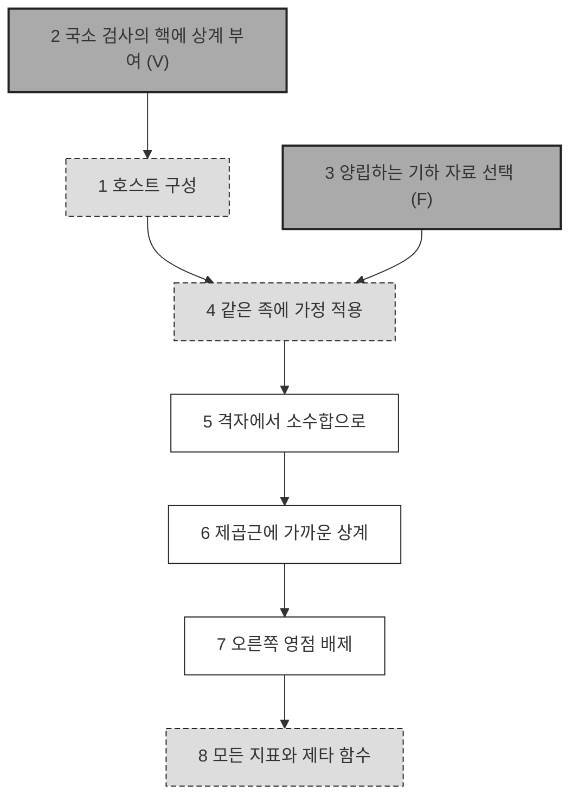

# 논증의 전체 흐름

AI-written, AI cross-reviewed; no human sign-off; not a claim that RH is proved

**한 문단으로 읽는 논증.** 리만 가설은 제타 함수의 자명하지 않은 모든 영점이 직선 $\Re(s)=1/2$ 위에 있다는 명제다. 소수와 그 거듭제곱에 가중치를 주어 세면 영점의 위치를 알아볼 수 있다. 아래의 해석적 가정 아래에서는 그 직선 오른쪽에 영점이 있으면 이 합이 예상되는 주항을 크게 웃돈다. 아무리 멀리 가도 어떤 긴 구간 전체에서 그 초과분이 제곱근에 가까운 상계 아래에 머물면 그런 영점을 배제할 수 있다. 조건부 논증의 목표는 산술과 기하를 이용해 그런 구간을 만드는 것이다.

영점은 함숫값이 0인 점이다. 제타 함수의 자명한 영점은 음의 짝수들이다. 영점, 유수, 해석적 연속의 배경은 다음 교재에서 읽을 수 있다. [G. Cho, *Complex Analysis and Riemann Surfaces: A Graduate Path to Algebraic Geometry*, arXiv:2601.06868](https://arxiv.org/abs/2601.06868).

[2절](../../editions/v0.1.0/paper_v8.pdf#page=5) · [정확한 다섯 명제](../../sources/lean-goals.md) · [English](../proof-at-a-glance.md)

## 여덟 단계

디리클레 지표는 정수에 주는 주기적인 가중치로, 곱을 보존한다. 원시 지표는 더 작은 법의 지표에서 유도되지 않는다. 1단계에는 이미 2단계의 V가 쓰인다. V가 기준값을 정하면 보조 소수 쌍을 고른다. 그 쌍에 대해 V가 주는 구간에서 호스트를 구성한다.

1. **소수를 셀 무대를 고른다.** 원시 지표를 고정하고 조건을 만족하는 각 척도에서 보조 소수 한 쌍을 골라 호스트를 구성한다. 그 척도에서 소수를 셀 때와 산술량을 추정할 때 서로 맞는 자료를 써야 한다. 호스트는 유리수체의 유한 확장인 수체와 선택한 소수 등 필요한 정보를 담으며, 척도가 달라지면 바뀔 수 있다. (자세히: [5.3절](../../editions/v0.1.0/paper_v8.pdf#page=40) · [B07](../../units/B07.md) · [P015](../../units/P015.md))

2. **소수별 검사에 보이지 않는 부분을 제한한다.** V는 허용되는 소수 쌍마다 구간 $[Y,Y^2]$를 주고 그 구간 전체에서 핵의 길이들을 가중해 더한 합을 제한한다. 어떤 허용 수체와 어떤 유한 소수 집합을 택해도 같은 구간에서 이 상계가 성립해야 한다. 각 길이는 해당 소수의 국소 검사에 보이지 않는 부분의 크기이며, V의 상계만으로는 소수합의 제곱근 추정을 얻을 수 없다. (자세히: [5.4절](../../editions/v0.1.0/paper_v8.pdf#page=45) · [P013](../../units/P013.md) · [V 읽기 지도](pillars/V.md))

3. **기하 자료를 한꺼번에 고른다.** 입력 F는 하나의 자료를 준다. 그 안에는 족들의 모음 하나와 그 모음 위의 선택 하나가 함께 들어 있다. 그래야 기하적 크기의 상계와 선택한 자료에 관한 조건을 함께 쓸 수 있다. (자세히: [5.5절](../../editions/v0.1.0/paper_v8.pdf#page=49) · [T02](../../units/T02.md) · [F 읽기 지도](pillars/F.md))

4. **같은 족에 가정을 적용한다.** V의 상계를 담은 호스트와 기하 자료 F를 그린 명제, 국소 함의 31개, 보충 입력 6개를 써서 결합한다. 이제 추정들이 모두 같은 격자와 수체, 같은 척도에 적용된다. 그린 명제는 유한체 위의 행렬군의 지표에 관한 것이며, Lean의 진술이 문헌의 공식과 일치하는지는 아직 확인하지 않았다. (자세히: [5.6절](../../editions/v0.1.0/paper_v8.pdf#page=50) · [V4-COND](../../units/V4-COND.md) · [P015](../../units/P015.md))

5. **격자에서 얻은 상계를 소수합으로 옮긴다.** 가중치를 주어 센 소수 거듭제곱의 합에서 주항을 빼면 지표를 가중치로 쓴 합과 정확히 일치한다. 이 등식 덕분에 각 격자 자료에서 따로 얻은 상계로 평균을 낸 뒤의 오차를 제한할 수 있다. (자세히: [5.1절](../../editions/v0.1.0/paper_v8.pdf#page=25) · [P021](../../units/P021.md) · [B10](../../units/B10.md) · [B09](../../units/B09.md) · [D561](../../units/D561.md))

6. **제곱근 지수가 나오는 까닭을 본다.** 척도 $x$에서 열의 수 $m$을 $\sqrt{x}$에 가깝게 고르면 대략 $x/m$과 $m$ 크기인 두 주요 오차항이 균형을 이룬다. V의 구간을 재조정하면 원시 지표에 대해 아무리 먼 곳에서도 어떤 구간 $[Y,Y^{3/2}]$ 전체에서 $x^{1/2+9\varepsilon}$이라는 상계를 얻는다. 양수 $\varepsilon$을 작게 고르면 지수를 필요한 만큼 $1/2$에 가깝게 할 수 있다. (자세히: [5.1절](../../editions/v0.1.0/paper_v8.pdf#page=25) · [B08](../../units/B08.md) · [P017](../../units/P017.md))

7. **직선 오른쪽의 영점을 배제한다.** 열린 띠 안에 실수부가 $1/2$보다 큰 영점이 있다고 가정하고, 상계의 지수를 그 사이에 잡는다. 란다우형 정리에 따르면 긴 구간마다 이 상계가 성립하면 그런 영점이 있을 수 없다. 소수합에는 여러 지표가 양의 가중치로 들어가므로 서로 같은 영점에서 나온 기여가 상쇄되지 않는다. (자세히: [부록 C.4](../../editions/v0.1.0/paper_v8.pdf#page=96) · [P022](../../units/P022.md) · [P023](../../units/P023.md) · [P018](../../units/P018.md))

8. **모든 지표와 제타 함수로 옮긴다.** 원시 지표에서 유도된 지표로 옮기고, 함수방정식으로 임계선 맞은편의 영점까지 다룬다. 이렇게 얻는 다섯 결론 가운데 제타 함수에 대한 결론은 법이 1인 지표에서 나온다. 직선 오른쪽에서 함수가 0이 되지 않는다는 명제에서는 주지표의 $s=1$이 예외다. (자세히: [부록 C](../../editions/v0.1.0/paper_v8.pdf#page=90) · [P003](../../units/P003.md) · [P004](../../units/P004.md) · [P005](../../units/P005.md) · [P007](../../units/P007.md) · [P001](../../units/P001.md) · [P002](../../units/P002.md))

열린 띠에서는 실수부가 0과 1 사이에 있다. 오른쪽 경계와 그 오른편은 고전적 비소멸 정리가 다룬다. 주지표에 대한 예외는 마지막 단계에 나온다.

## 어느 단계가 어디에 쓰이는가?

화살표는 한 단계가 어느 단계에 쓰이는지 나타낸다. 흰 칸은 명시한 가정 아래 유도를 써 둔 단계(5–7), 연한 칸은 개요가 있는 단계(1, 4, 8)다. 짙은 칸은 전체 유도가 현재 Lean에만 있는 입력(2, 3)이다. 5단계에서는 상계의 유도를 써 두었고, 균형 항등식 자체에는 개요가 있다(D561).

> **어디에 일이 집중되어 있나.** V와 F가 차지하는 부분은 집계한 Lean 소스 9,567,045줄 가운데 4,565,893줄(47.73%, 약 48%)이다. 두 입력 모두 처음부터 끝까지 손으로 따라갈 유도는 아직 없다. 두 입력에서 결론으로 가는 조건부 논증은 짧다. 그 논증을 따라 나눈 네 블록에는 집계한 줄 수의 1.92%가 들어 있고, 나머지 두 행이 50.36%를 차지한다.

## 각 부분의 규모

| 부분과 선언 | 지배하는 Lean 줄 수 | 논문 v8의 읽기 구간 |
|---|---:|---|
| 수체 선택 · [B07](../../units/B07.md) | 31,622 | [40](../../editions/v0.1.0/paper_v8.pdf#page=40)–[44](../../editions/v0.1.0/paper_v8.pdf#page=44)쪽 (5쪽) |
| 셀머 상계 V · [P013](../../units/P013.md) | 886,201 | [45](../../editions/v0.1.0/paper_v8.pdf#page=45)–[49](../../editions/v0.1.0/paper_v8.pdf#page=49)쪽 (5쪽) |
| 기하 자료의 공통 선택 F · [T02](../../units/T02.md) | 3,679,692 | [49](../../editions/v0.1.0/paper_v8.pdf#page=49)–[50](../../editions/v0.1.0/paper_v8.pdf#page=50)쪽 (2쪽) |
| 기하적 추정의 결합 · [B05](../../units/B05.md) | 146,214 | [43](../../editions/v0.1.0/paper_v8.pdf#page=43)–[44](../../editions/v0.1.0/paper_v8.pdf#page=44)쪽 (2쪽) |
| 격자 오차에서 소수합으로 · [P017](../../units/P017.md) | 3,365 | [25](../../editions/v0.1.0/paper_v8.pdf#page=25)–[35](../../editions/v0.1.0/paper_v8.pdf#page=35)쪽 (11쪽) |
| 긴 구간에서의 란다우형 판정 · [P022](../../units/P022.md) | 863 | [96](../../editions/v0.1.0/paper_v8.pdf#page=96)–[100](../../editions/v0.1.0/paper_v8.pdf#page=100)쪽 (5쪽) |
| 다섯 결론 가운데 P003 · [P003](../../units/P003.md) | — | [90](../../editions/v0.1.0/paper_v8.pdf#page=90)–[91](../../editions/v0.1.0/paper_v8.pdf#page=91)쪽 (2쪽) |

가운데 열은 모든 지표에 관한 공통 선언에서 출발할 때 반드시 해당 선언을 거쳐야 도달하는 Lean 줄 수다. 행끼리 겹칠 수 있다. P003은 이 그래프 밖에 있다. 오른쪽 열은 이번 판본(v8)에서 고른 읽기 구간으로 양 끝 쪽을 모두 센다. V와 F의 짧은 구간에서는 두 입력의 내용을 설명한다. P022 한 선언이 지배하는 줄 수는 863이다. 표 2에서는 P018, P019, P023을 합친 블록을 세므로 2,115줄이다. [집계 방법](../../sources/coverage.md) · [겹치지 않는 영역](../../progress/README.md)

## 어디까지 확인했나?

Alpöge의 Lean 개발은 다섯 결론을 선언한다. 제3자의 기록에 따르면 Lean 커널은 컴파일된 개발을 받아들였다. 이 프로젝트는 그 검사를 다시 실행하지 않았다. 논문은 조건부 논증의 개요를 제시한다. 아틀라스에는 개별 증명 단계를 사람이 확인했다는 기록이 아직 없다. [외부 검사](../../sources/kernel-audit.md) · [검토 현황](STATUS.md) · [판본 장부](../../data/editions.json)
