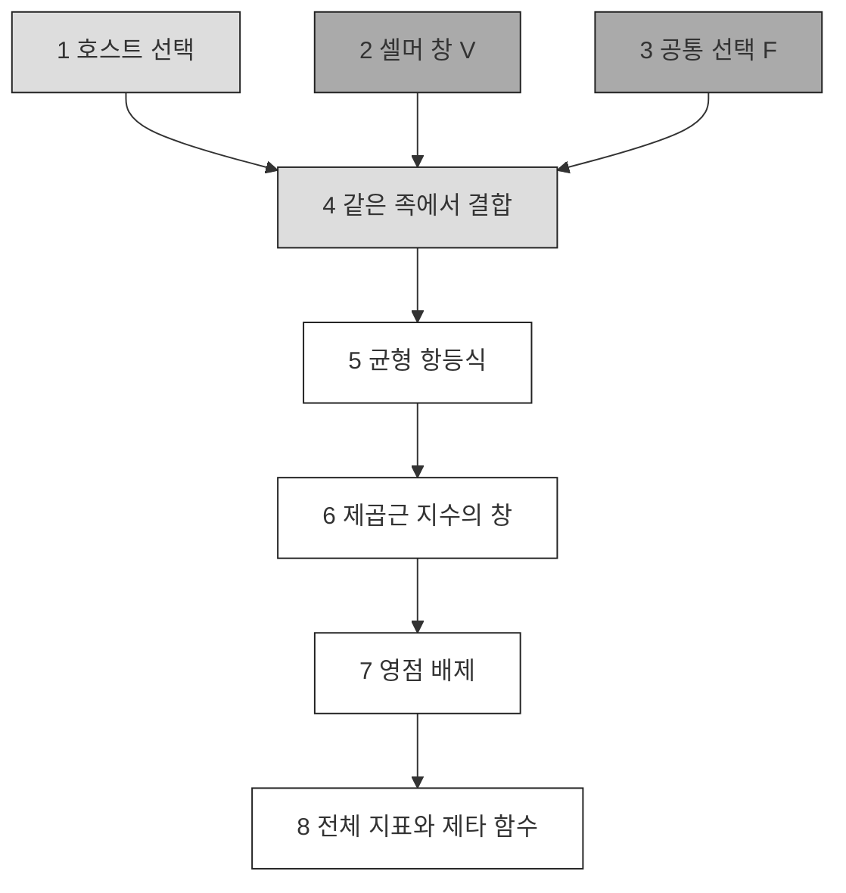

# 논증의 전체 흐름

AI-written, AI cross-reviewed; no human sign-off; not a claim that RH is proved

$\Re(s)>1$에서는 리만 제타 함수를 소수마다 한 인수를 갖는 곱으로 나타낼 수 있다. 영점은 함수의 값이 0이 되는 복소수다. 리만 가설은 음의 짝수에 있는 영점을 제외한 모든 영점이 수직선 $\Re(s)=1/2$ 위에 놓인다고 말한다. 영점의 위치를 알아내려고 왜 소수를 셀까? 아래의 해석적 가정 아래에서는 이 선 오른쪽의 영점이 가중 소수합을 위쪽으로 크게 흔든다. 아무리 먼 곳에서도 어떤 긴 구간 전체에 제곱근 크기에 작은 지수 손실만 더한 상계가 성립하면 그런 영점을 배제할 수 있다. 그래서 논증은 그런 구간을 만드는 데 집중한다. 논문 v7은 목표에서 출발해 필요한 입력으로 거슬러 올라가고, 블루프린트는 원래 입력 20개에서 출발해 손으로 확인할 수 있는 논증을 쌓아 간다. [논문 v7 제2절](../../editions/v0.1.0/paper_v7.pdf#page=5) · [정확한 다섯 명제](../../sources/lean-goals.md) · [English](../proof-at-a-glance.md)

## 여덟 단계

여기에서 *창*은 여러 척도를 담은 구간을 뜻한다. 처음 세 단계는 함께 쓰일 재료를 소개한다. 실제 구성에서는 V가 척도의 하한을 먼저 정하고 그 뒤에 보조 소수를 고른다.

1. **소수를 셀 무대를 고른다.** 원시 디리클레 지표 하나에서 출발한다. 지표는 정수에 주는 주기적이고 곱셈을 보존하는 가중치이고, 원시라는 말은 더 작은 법에서 온 가중치가 아니라는 뜻이다. 보조 소수들과 수체(유리수체의 유한 확장)를 고른다. 이 프로젝트는 이 수체를 ‘호스트’라고 부른다. 각 척도에서는 산술 추정과 소수 계수에 양립하는 자료를 써야 하고, 척도가 달라지면 호스트도 달라질 수 있다. [호스트 구성 B07](../../units/B07.md) · [조립 P015](../../units/P015.md)
2. **한 구간에서 국소 검사로 구별할 수 없는 양을 제한한다.** 셀머 군은 소수별로 정한 국소 조건을 만족하는 전역 산술적 대상의 동치류를 모은 군이다. 입력 V는 허용되는 소수 쌍마다 공통 구간을 주고, 그 구간에서 국소 검사에 보이지 않는 부분인 핵들의 길이에 가중치를 주어 더한 값을 제한한다. 이 상계는 구간의 각 척도에서 어떤 허용 호스트를 선택해도 적용되어야 한다. [셀머 창 V · P013](../../units/P013.md) · [V의 양화 순서와 증명 범위](pillars/V.md)
3. **함께 쓸 수 있는 기하 자료를 찾는다.** 입력 F는 여러 자료의 족을 담은 한 모음에서 격자 조건과 세타 조건을 동시에 만족시키는 공통 선택을 요구한다. 세타 이론은 격자 위의 합을 대칭성을 가진 함수와 잇는다. 조건마다 따로 고른다면 2단계의 산술 자료에 같은 기하적 추정을 적용할 근거가 사라진다. [공통 선택 F · T02](../../units/T02.md) · [F의 쓰임](pillars/F.md)
4. **추정들을 같은 족에 모은다.** V와 F에 더해 유한체 위의 유한 행렬군에 관한 Green의 지표 공식, 국소 함의 31개, 보충 입력 S1–S6을 사용한다. 이 가정들이 소수를 세는 자료를 선택한 격자에 연결하고 같은 족 위에서 오차를 제어한다. S6에는 유도에 쓰는 L함수의 고전적 성질이 들어 있다. [전체 가정 V4-COND](../../units/V4-COND.md) · [조립 P015](../../units/P015.md)
5. **격자 추정을 소수 계수 추정으로 옮긴다.** 격자는 일차 독립인 벡터들의 정수 계수 결합을 모두 모은 점 집합이다. 여기서는 소수와 그 거듭제곱을 가중해 센 값에서 예상 주항을 뺀 차이가 지표들의 합으로 계산되는 양과 정확히 같다는 항등식을 쓴다. 이 등식 덕분에 각 척도에서 별도로 가정한 격자 상계를 지표에 걸쳐 평균하여 계수 오차를 제어할 수 있다. [점별 격자 상계 P021](../../units/P021.md) · [오차 B10](../../units/B10.md) · [지표 평균 B09](../../units/B09.md)
6. **지수 $1/2$가 나오는 이유를 본다.** 척도 $x$에서 약 $\sqrt{x}$개의 열을 쓴다. 열의 수를 $m$이라 하면, 이 수로 나누었을 때 대략 $x/m$ 크기인 항과 $m$ 크기인 항이 균형을 이룬다. 명시한 비교 가정을 쓰면 아무리 멀리 가도 어떤 구간 $[Y,Y^{3/2}]$ 전체에서 가중 소수합이 $x^{1/2+9\varepsilon}$ 이하이다. 양수 $\varepsilon$을 작게 잡아 지수를 필요한 만큼 $1/2$에 가깝게 할 수 있다. [한 척도에서의 상계 B08](../../units/B08.md) · [창 부등식 P017](../../units/P017.md)
7. **긴 구간의 상계로 영점을 배제한다.** 실수부가 $\beta>1/2$인 영점이 있다고 가정한다. $1/2<\theta<\min(1,\beta)$를 택하고, $1/2+9\varepsilon<\theta$가 되도록 $\varepsilon$을 줄인다. 열린 띠 $0<\Re(s)<1$에서는 란다우형 판정에 따라 실수부가 $\theta$보다 큰 영점이 있으면 아무리 먼 곳에서도 구간 전체에 이런 한쪽 상계가 성립할 수 없다. 가중치가 양수여서 영점이 겹쳐도 그 기여는 상쇄되지 않는다. 띠의 오른쪽 경계와 그 오른편에는 고전적 비소멸 결과를 쓴다. [란다우형 판정 P022](../../units/P022.md) · [양의 가중치 P023](../../units/P023.md) · [적용 P018](../../units/P018.md)
8. **모든 지표와 제타 함수로 옮긴다.** 각 디리클레 지표는 원시 지표에서 유도되고, 법이 1인 주지표는 제타 함수를 준다. 법을 바꿀 때의 공식과 임계선 양쪽을 잇는 대칭인 함수방정식을 쓰면 결론의 다섯 형태를 얻는다. 주지표의 경우 $s=1$의 극은 예외다. [전체 지표 P003](../../units/P003.md) · [열린 띠 P004](../../units/P004.md) · [원시 지표 P005](../../units/P005.md) · [원시 지표의 대칭 P007](../../units/P007.md) · [제타 함수 P001](../../units/P001.md) · [제타 영점 P002](../../units/P002.md)

## 어느 단계가 어디에 쓰이는가?

화살표는 ‘다음 단계에 쓰인다’를 뜻한다. 흰 칸은 명시한 가정 아래 유도를 써 둔 단계(5–8), 연한 회색은 개요가 있는 단계(1, 4), 짙은 회색은 전체 유도가 현재 Lean에만 있는 입력(2, 3)이다. 이는 그 단계에 대해 어느 범위까지 글로 설명했는지를 나타낸다. 개요에도 개별 계산의 완전한 유도가 들어갈 수 있다. [상세 논증 지도](../../MAP.md)

## 각 부분의 규모

가운데 열은 공통된 ‘모든 지표’ 선언에서 출발하여 어떤 Lean 소스 줄로 가는 모든 경로가 지정한 선언을 거칠 때 그 줄을 센 것이다. 이를 그 선언이 *지배하는 줄 수*라고 한다. 마지막 열은 **논문 v6의 인쇄 쪽수**로 고른 읽기 구간이다. 가정을 설명하는 부분도 포함하므로 V와 F의 짧은 구간은 두 입력의 전체 유도가 아니다. 블록은 겹칠 수 있어 줄 수를 단순히 합산할 수 없다. [소스 그래프와 집계 방법](../../sources/coverage.md) · [판본 장부](../../data/editions.json)

| 부분과 선언 | 지배하는 Lean 줄 수 | 논문 v6의 읽기 구간 |
|---|---:|---|
| 호스트 선택 · [B07](../../units/B07.md) | 31,622 | 21–26쪽 (6쪽) |
| 셀머 창 V · [P013](../../units/P013.md) | 886,201 | 27–30쪽 (4쪽) |
| 기하 자료의 공통 선택 F · [T02](../../units/T02.md) | 3,679,692 | 31–32쪽 (2쪽) |
| 기하와 산술 추정의 조립 · [B05](../../units/B05.md) | 146,214 | 25–26쪽 (2쪽) |
| 격자 오차에서 소수합 창으로 · [P017](../../units/P017.md) | 3,365 | 5–15쪽 (11쪽) |
| 란다우형 판정 · [P022](../../units/P022.md) | 863 | 79–83쪽 (5쪽) |
| 모든 지표에 대한 공개 결론 · [P003](../../units/P003.md) | — | 72–73쪽 (다섯 결론을 소개하는 2쪽) |

V와 F가 각각 지배하는 서로 겹치지 않는 영역을 합하면 코어 9,567,045줄 가운데 4,565,893줄(47.73%)이다. 표에 나온 짧은 구간은 이 영역을 읽기 위한 안내다. P003은 공통 ‘모든 지표’ 선언을 뿌리로 한 그래프 밖에 있는 공개 결론이어서, 이 그래프에서는 P003의 지배 줄 수를 계산하지 않는다. [겹치지 않는 영역과 줄 수](../../progress/README.md)

## 현재 어디까지 확인했는가?

Alpöge의 Lean 개발은 다섯 결론을 선언한다. 제3자의 기록은 Lean 커널이 컴파일된 개발을 받아들였다고 보고하며, 이 프로젝트는 그 검사를 다시 실행하지 않았다. 논문은 조건부 논증의 구조를 설명하고 해석적 유도를 제시한다. V와 F를 손으로 처음부터 끝까지 따라갈 유도는 아직 없다. 아틀라스는 독자가 각 단계를 점검할 수 있도록 판본과 검토 구간을 기록하며, 현재 사람이 확인했다고 기록된 단계는 없다. [외부 검사](../../sources/kernel-audit.md) · [서면 논증의 현황](STATUS.md) · [판본 장부](../../data/editions.json)
