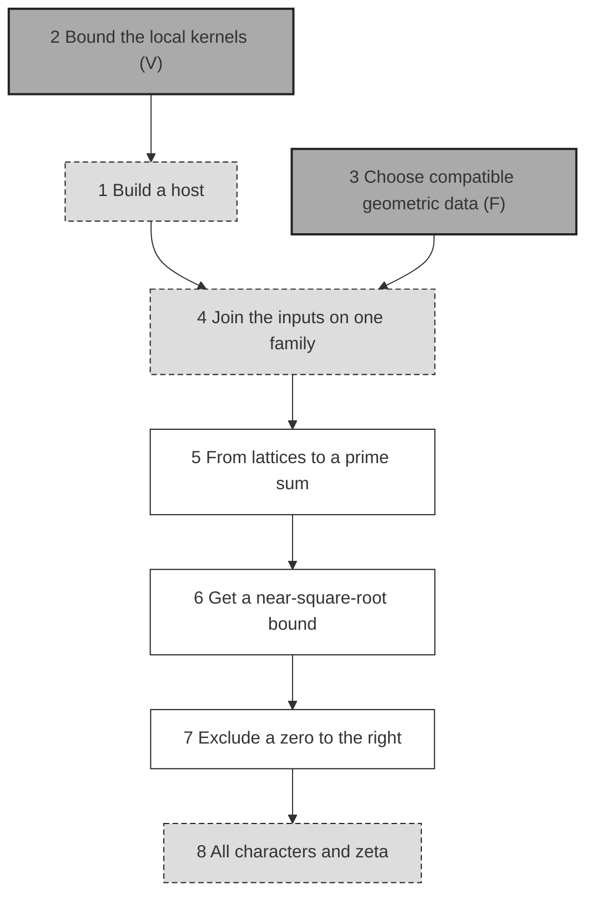

# The proof at a glance

AI-written, AI cross-reviewed; no human sign-off; not a claim that RH is proved

**The argument in one paragraph.** The Riemann hypothesis places every nontrivial zeta zero on the line $\Re(s)=1/2$. Count primes and their powers with suitable weights. Under our analytic assumptions, a zero to the right forces that count far above its main term. A near-square-root upper bound on this excess throughout arbitrarily distant long intervals excludes such a zero. The arithmetic and geometric assumptions supply those intervals.

A zero is a point where a function vanishes. Here the trivial zeta zeros are the negative even integers. For background on zeros, residues and analytic continuation, see [G. Cho, *Complex Analysis and Riemann Surfaces: A Graduate Path to Algebraic Geometry*, arXiv:2601.06868](https://arxiv.org/abs/2601.06868).

[§2](../editions/v0.1.0/paper_v8.pdf#page=5) · [Five precise statements](../sources/lean-goals.md) · [한국어](ko/proof-at-a-glance.md)

## Eight steps

A Dirichlet character assigns periodic, multiplicative weights to integers. A primitive character does not come from a smaller modulus. Step 1 already uses V from step 2. V sets a threshold. The construction next chooses the prime pair, obtains V’s interval and builds the host there.

1. **Choose where to count.** For a primitive character, choose a pair of auxiliary primes and build a host at each eligible scale. The prime count and the arithmetic estimates at that scale must use compatible data. A host records a finite extension of the rational numbers, the chosen primes and further data, and may change with the scale. (Details: [§5.3](../editions/v0.1.0/paper_v8.pdf#page=40) · [B07](../units/B07.md) · [P015](../units/P015.md))

2. **Bound what prime-by-prime tests miss.** For each admissible prime pair, V bounds a weighted sum of kernel lengths throughout one interval $[Y,Y^2]$. The same interval must work for every allowed field and finite set of primes. These lengths measure classes missed by local tests, and V’s bound alone gives no square-root estimate for the prime sum. (Details: [§5.4](../editions/v0.1.0/paper_v8.pdf#page=45) · [P013](../units/P013.md) · [V reading map](../pillars/V.md))

3. **Make one geometric choice.** Input F supplies one record containing a class of families and one selection on that class. The bounds on sizes and the conditions on selected data can then be used together. (Details: [§5.5](../editions/v0.1.0/paper_v8.pdf#page=49) · [T02](../units/T02.md) · [F reading map](../pillars/F.md))

4. **Use the inputs on the same family.** Join the host carrying V’s estimate and the geometric choice F using Green’s assertion, 31 local implications and six supplementary inputs. The later bounds now concern the same lattice, field and scale. The Lean assertion about matrix groups over finite fields still needs comparison with Green’s published character formula. (Details: [§5.6](../editions/v0.1.0/paper_v8.pdf#page=50) · [V4-COND](../units/V4-COND.md) · [P015](../units/P015.md))

5. **Turn a lattice bound into a prime-counting bound.** An exact identity relates the weighted prime-power count, after subtracting its main term, to a sum with character weights. This lets a separate bound for each lattice datum control the error after averaging. (Details: [§5.1](../editions/v0.1.0/paper_v8.pdf#page=25) · [P021](../units/P021.md) · [B10](../units/B10.md) · [B09](../units/B09.md) · [D561](../units/D561.md))

6. **Find the square-root exponent.** Choosing about $\sqrt{x}$ columns balances the two main errors near $x/m$ and $m$, where $m$ counts columns. Rescaling V’s intervals gives arbitrarily distant intervals $[Y,Y^{3/2}]$ with upper bound $x^{1/2+9\varepsilon}$ for the primitive-character case. Taking the positive number $\varepsilon$ small brings the exponent as close to one half as needed. (Details: [§5.1](../editions/v0.1.0/paper_v8.pdf#page=25) · [B08](../units/B08.md) · [P017](../units/P017.md))

7. **Rule out a zero to the right.** For a zero in the open strip with real part above one half, choose a bound exponent strictly between those two numbers. A theorem of Landau type says the resulting upper bounds on long intervals exclude such a zero. The prime sum combines several characters with positive weights, so contributions from a shared zero cannot cancel. (Details: [§C.4](../editions/v0.1.0/paper_v8.pdf#page=96) · [P022](../units/P022.md) · [P023](../units/P023.md) · [P018](../units/P018.md))

8. **Pass to every character and to zeta.** Pass from primitive characters to induced characters, then use the functional equation to reflect zeros across the line. This gives the five stated conclusions, including zeta through the character of modulus one. The right-hand nonvanishing statement excepts the principal character at $s=1$. (Details: [§C](../editions/v0.1.0/paper_v8.pdf#page=90) · [P003](../units/P003.md) · [P004](../units/P004.md) · [P005](../units/P005.md) · [P007](../units/P007.md) · [P001](../units/P001.md) · [P002](../units/P002.md))

In the open strip, the real part lies strictly between zero and one. The classical nonvanishing results cover its right boundary and the region beyond it, with the principal exception in step 8.

## Which steps use which inputs?

Each arrow points to the step that uses the preceding input. White boxes show written deductions under stated assumptions (5–7). Light boxes show outlines (1, 4, 8). Dark boxes mark inputs whose full derivations are available only in Lean (2, 3). In step 5 the bound is written in full. The balance identity itself has an outline (D561).

> **Where the weight lies.** V and F together account for 4,565,893 of 9,567,045 measured Lean lines (47.73%, about 48%). Neither input has a complete written derivation here. The conditional deduction using them is short. Four blocks along that chain account for 1.92% of the measured lines. Two other rows account for 50.36%.

## How big is each part?

| Block and declaration | Dominated Lean lines | Selected paper v8 passage |
|---|---:|---|
| Choosing the host field · [B07](../units/B07.md) | 31,622 | pp. [40](../editions/v0.1.0/paper_v8.pdf#page=40)–[44](../editions/v0.1.0/paper_v8.pdf#page=44) (5 pages) |
| The Selmer bound V · [P013](../units/P013.md) | 886,201 | pp. [45](../editions/v0.1.0/paper_v8.pdf#page=45)–[49](../editions/v0.1.0/paper_v8.pdf#page=49) (5 pages) |
| The compatible choice F · [T02](../units/T02.md) | 3,679,692 | pp. [49](../editions/v0.1.0/paper_v8.pdf#page=49)–[50](../editions/v0.1.0/paper_v8.pdf#page=50) (2 pages) |
| Joining the geometric estimates · [B05](../units/B05.md) | 146,214 | pp. [43](../editions/v0.1.0/paper_v8.pdf#page=43)–[44](../editions/v0.1.0/paper_v8.pdf#page=44) (2 pages) |
| From lattice errors to prime sums · [P017](../units/P017.md) | 3,365 | pp. [25](../editions/v0.1.0/paper_v8.pdf#page=25)–[35](../editions/v0.1.0/paper_v8.pdf#page=35) (11 pages) |
| Landau’s criterion on windows · [P022](../units/P022.md) | 863 | pp. [96](../editions/v0.1.0/paper_v8.pdf#page=96)–[100](../editions/v0.1.0/paper_v8.pdf#page=100) (5 pages) |
| The five conclusions, with P003 shown · [P003](../units/P003.md) | — | pp. [90](../editions/v0.1.0/paper_v8.pdf#page=90)–[91](../editions/v0.1.0/paper_v8.pdf#page=91) (2 pages) |

The middle column counts Lean lines reached only through the listed declaration from the common all-characters starting point. Different rows can overlap. P003 lies outside this graph. The right column gives selected printed pages in this edition (v8), counting both endpoints. The short readings on V and F describe the inputs. P022 alone accounts for 863 lines. Table 2 groups it with P018, P019 and P023, giving 2,115 lines. [Counting method](../sources/coverage.md) · [Disjoint regions](../progress/README.md)

## What has been checked?

Alpöge’s Lean development states the five conclusions. A third-party record reports that Lean’s kernel accepted the compiled development. This project did not rerun that check. The paper outlines a conditional deduction. The atlas records no human checks of individual proof steps. [External audit](../sources/kernel-audit.md) · [Status](../STATUS.md) · [Edition register](../data/editions.json)
