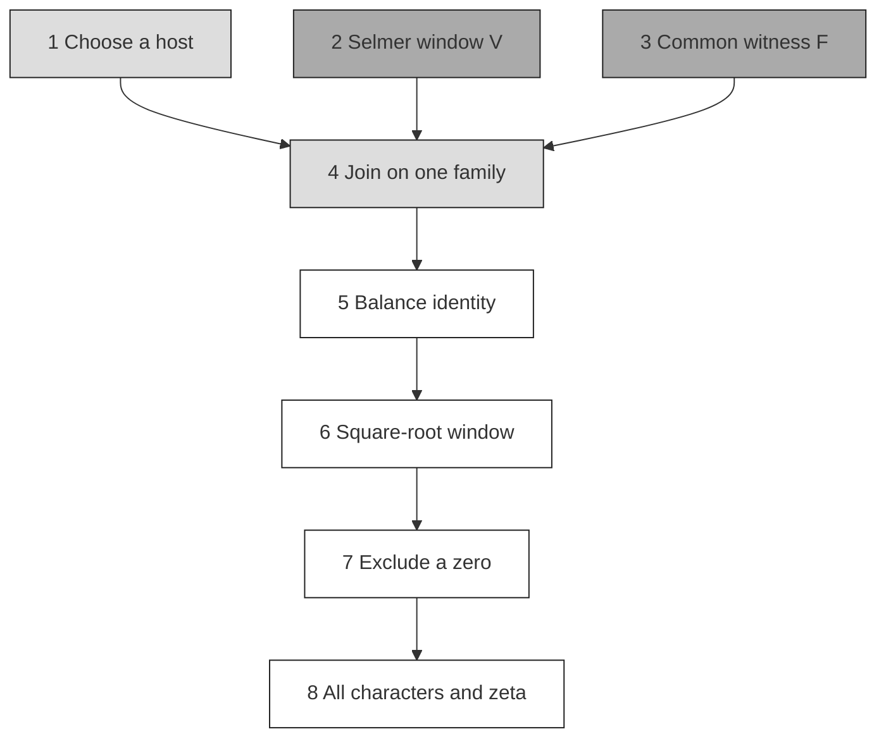

# The proof at a glance

AI-written, AI cross-reviewed; no human sign-off; not a claim that RH is proved

For $\Re(s)>1$, the Riemann zeta function is a product with one factor for each prime. Its zeros are complex numbers where the function vanishes. The Riemann hypothesis says that every zero apart from the familiar negative even integers lies on the vertical line $\Re(s)=1/2$. Why count primes to locate a zero? Under the analytic hypotheses below, a zero to the right would force an upward fluctuation in a suitably weighted prime sum. An upper bound of square-root size with a small loss, holding all the way across arbitrarily distant long intervals, rules this out. The strategy is therefore to construct those intervals. Paper v7 traces this deduction from the goal back to its inputs. The companion blueprint starts from the 20 original inputs and develops the pieces a reader can check by hand. [Paper v7, §2](../editions/v0.1.0/paper_v7.pdf#page=5) · [Five precise statements](../sources/lean-goals.md) · [한국어](ko/proof-at-a-glance.md)

## Eight steps

Here a *window* is an interval of scales. The first three steps describe ingredients. In the construction, V fixes the size threshold before the auxiliary primes are chosen.

1. **Choose a setting for counting primes.** Start with a primitive Dirichlet character, a periodic multiplicative weight on integers that does not come from a smaller modulus, and choose auxiliary primes and a number field, a finite extension of the rationals, called the *host* in this project. At each eligible scale, the arithmetic estimates and prime count must use compatible data. The host can vary with the scale. [Host construction B07](../units/B07.md) · [Assembly P015](../units/P015.md)
2. **Bound the arithmetic ambiguity on a window.** A Selmer group records global arithmetic classes subject to local conditions, which test the classes one prime at a time. The input called V bounds a weighted sum of the lengths of kernels, measuring classes that local tests fail to distinguish, on a common interval for each admissible prime pair. The bound must apply to whichever admissible host is chosen at each scale in the interval. [V, unit P013](../units/P013.md) · [Quantifiers and proof boundary](../pillars/V.md)
3. **Find geometric data that work together.** The input called F requires one choice across a class of families where the lattice data and the theta data, which relate sums over lattices to functions with prescribed symmetries, satisfy the needed conditions together. Separate choices for each condition would leave the geometric estimate with no reason to apply to the arithmetic data in step 2. [F, unit T02](../units/T02.md) · [What the common choice supplies](../pillars/F.md)
4. **Bring the estimates onto the same family.** V and F enter a comparison along with Green’s character formula for finite groups of matrices over finite fields, 31 local implications and supplementary inputs S1–S6. Together these assumptions connect the prime-counting data to the selected lattices and control the errors on that same family. S6 names the classical facts about L-functions used in the deduction. [Full hypothesis list V4-COND](../units/V4-COND.md) · [Assembly P015](../units/P015.md)
5. **Turn a lattice estimate into a prime-counting estimate.** A lattice consists of the integer combinations of a set of linearly independent vectors. Here an exact balance identity identifies the difference between a weighted prime-power count and its expected main term with a quantity computed from character sums. This equality lets a separate bound on the lattice data at each scale control the error after averaging the characters. [Lattice estimate P021](../units/P021.md) · [Error B10](../units/B10.md) · [Character average B09](../units/B09.md)
6. **See where one half comes from.** At scale $x$ the construction uses about $\sqrt{x}$ columns: dividing by their number balances terms of size roughly $x/m$ and $m$, where $m$ is the column count. After the stated comparisons, the weighted prime sum is at most $x^{1/2+9\varepsilon}$ throughout arbitrarily distant intervals $[Y,Y^{3/2}]$. Choosing a small positive $\varepsilon$ brings the exponent as close to one half as the argument needs. [One-scale bound B08](../units/B08.md) · [Window inequality P017](../units/P017.md)
7. **Use a long interval to exclude a zero.** Suppose a zero has real part $\beta>1/2$. Choose $\theta$ strictly between $1/2$ and $\min(1,\beta)$, and then $\varepsilon$ so small that $1/2+9\varepsilon<\theta$. For zeros in the open strip $0<\Re(s)<1$, the Landau-type criterion says that a zero beyond $\theta$ is incompatible with the one-sided upper bound throughout arbitrarily distant intervals. Positive weights keep the contributions of coincident zeros from cancelling. Classical nonvanishing treats the boundary and the region to its right. [Window criterion P022](../units/P022.md) · [Positive weights P023](../units/P023.md) · [Application P018](../units/P018.md)
8. **Pass from one character to all characters and to zeta.** Every Dirichlet character is induced by a primitive character. The principal character of modulus one gives the zeta function. Changing modulus and applying the functional equation, the symmetry relating the two sides of the critical line, gives the five stated forms of the conclusion, with the principal-character pole at $s=1$ excepted. [All characters P003](../units/P003.md) · [All characters in the strip P004](../units/P004.md) · [Primitive characters P005](../units/P005.md) · [Primitive reflection P007](../units/P007.md) · [Zeta P001](../units/P001.md) · [Zeta zeros P002](../units/P002.md)

## Which steps use which inputs?

Each arrow means “is used in”. White boxes show a written deduction under its assumptions (5–8), light gray an outline (1, 4), and dark gray an input whose full derivation is available only in Lean (2, 3). These labels describe the written material available at each step. An outline can include fully written local calculations. [Detailed map](../MAP.md)

## How big is each part?

The second column counts Lean source lines *dominated* by one declaration: the paths from the shared “all characters” starting point to those lines all pass through that declaration. The last column gives selected passages in **paper v6, by printed page**. These are reading lengths, including explanations of hypotheses. The two short passages on V and F do not derive those inputs. Blocks can overlap and the counts must not be added. [Source graph and counting method](../sources/coverage.md) · [Edition register](../data/editions.json)

| Block and declaration | Dominated Lean lines | Selected paper v6 passage |
|---|---:|---|
| Host choice · [B07](../units/B07.md) | 31,622 | pp. 21–26 (6 pages) |
| Selmer window V · [P013](../units/P013.md) | 886,201 | pp. 27–30 (4 pages) |
| Geometric witness F · [T02](../units/T02.md) | 3,679,692 | pp. 31–32 (2 pages) |
| Joining geometric and arithmetic estimates · [B05](../units/B05.md) | 146,214 | pp. 25–26 (2 pages) |
| Lattice error to prime-sum window · [P017](../units/P017.md) | 3,365 | pp. 5–15 (11 pages) |
| Landau criterion · [P022](../units/P022.md) | 863 | pp. 79–83 (5 pages) |
| Public conclusion for all characters · [P003](../units/P003.md) | — | pp. 72–73 (2 pages on the five targets) |

The separate regions dominated by V and F account for 4,565,893 of 9,567,045 core lines (47.73%). The short passages in the table are reading maps into those regions. P003 is an exported conclusion outside the graph rooted at the shared all-characters declaration. That graph supplies no dominated count for P003. [Disjoint regions and source counts](../progress/README.md)

## What is established here?

Alpöge’s Lean development states the five conclusions. A third-party record reports kernel acceptance of the compiled development. This project did not rerun those checks. The paper explains the conditional deduction and spells out its analytic steps. A complete hand derivation of V or F is still missing. The atlas records each edition and each reviewed passage so that future readers can check individual steps. No step currently has a recorded human check. [External audit](../sources/kernel-audit.md) · [Status of the written argument](../STATUS.md) · [Editions](../data/editions.json)
