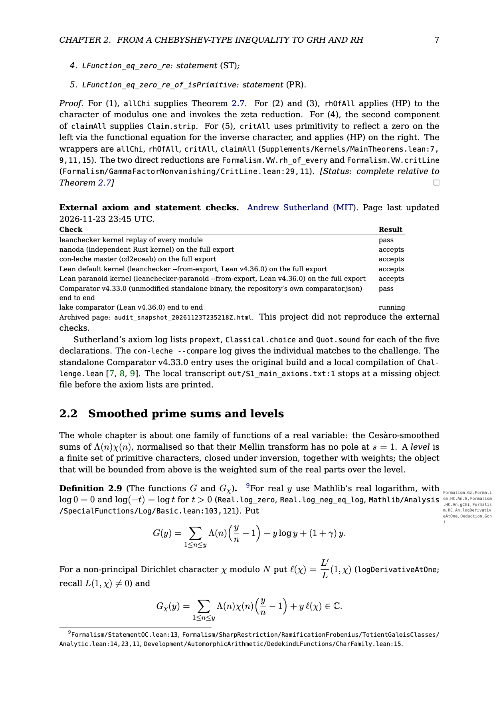
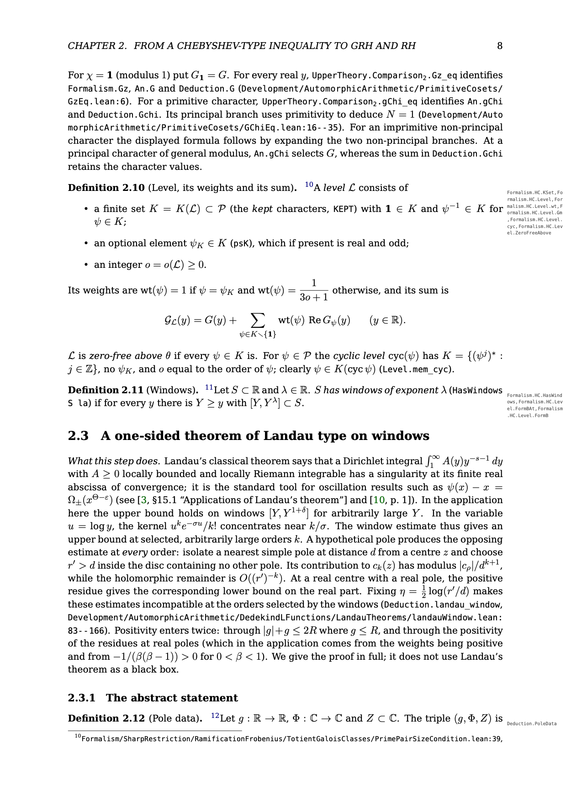
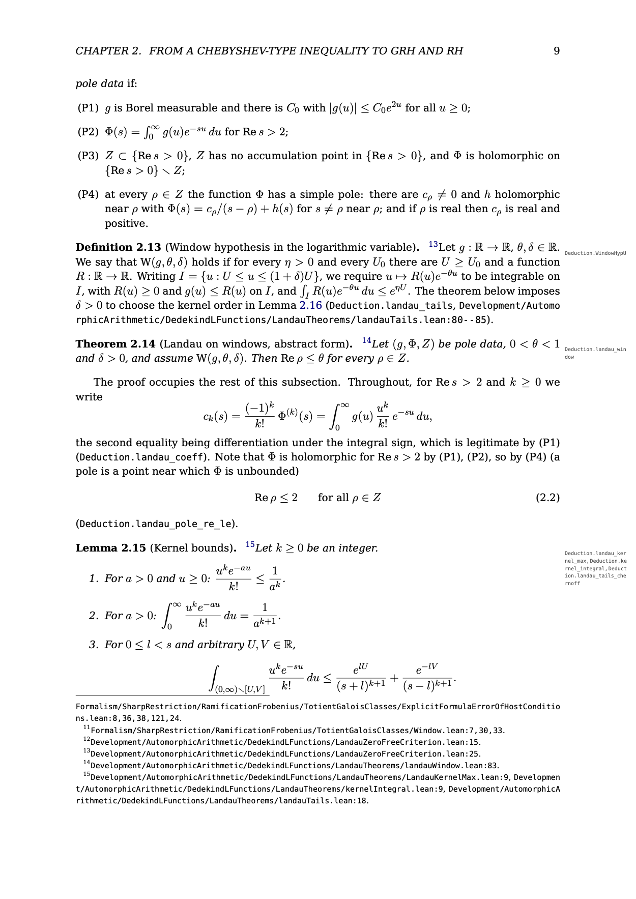
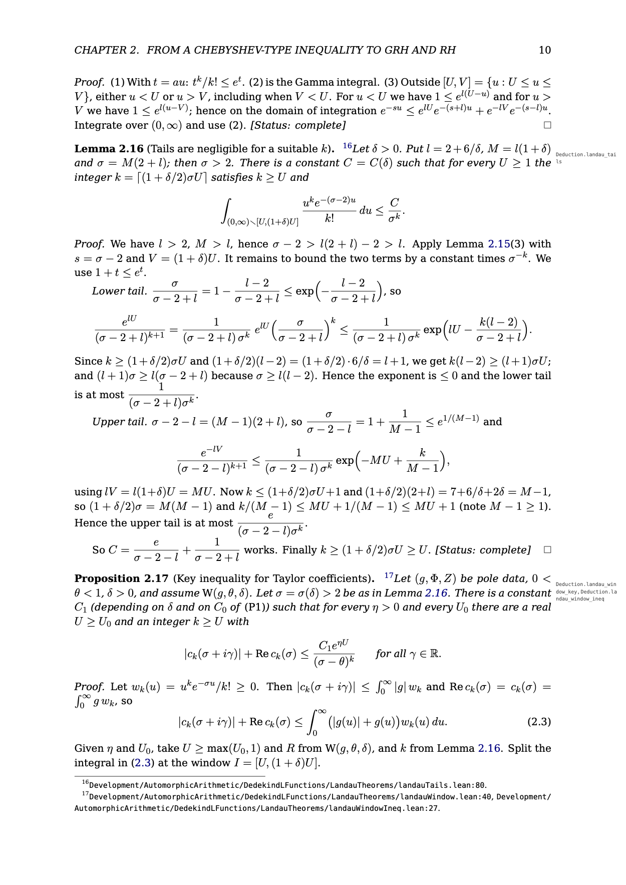
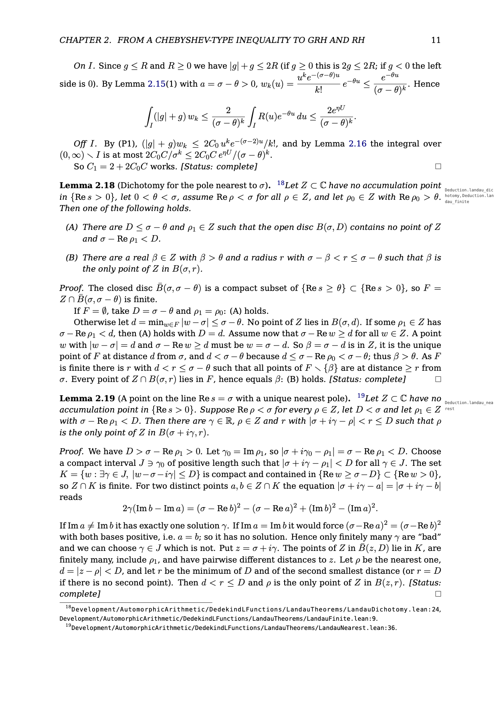
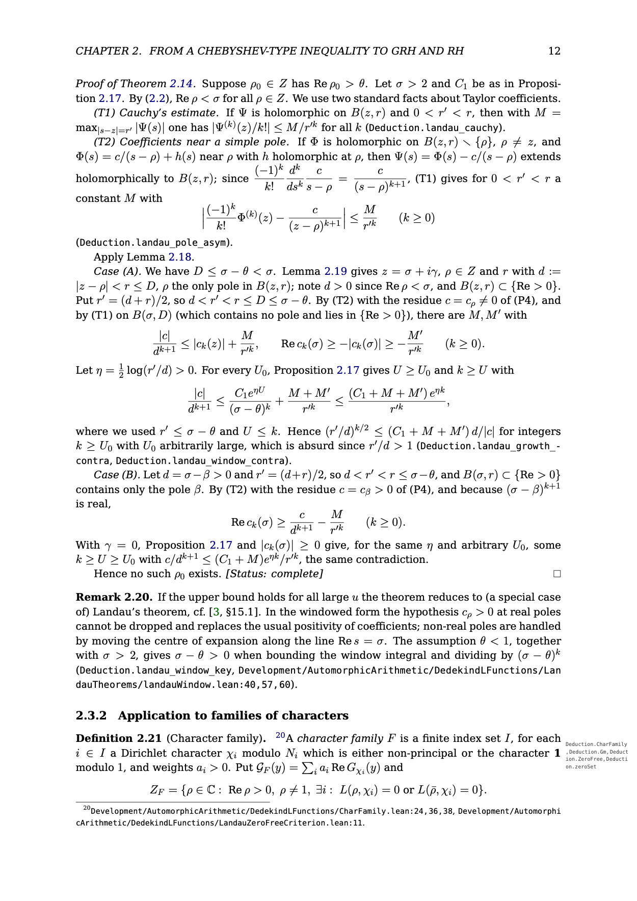
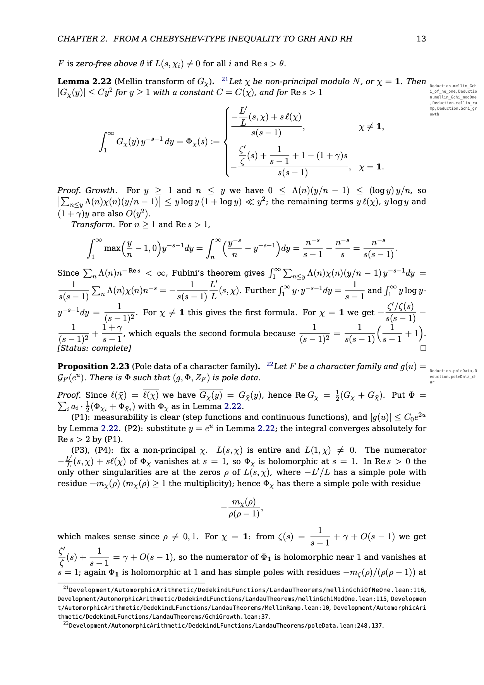
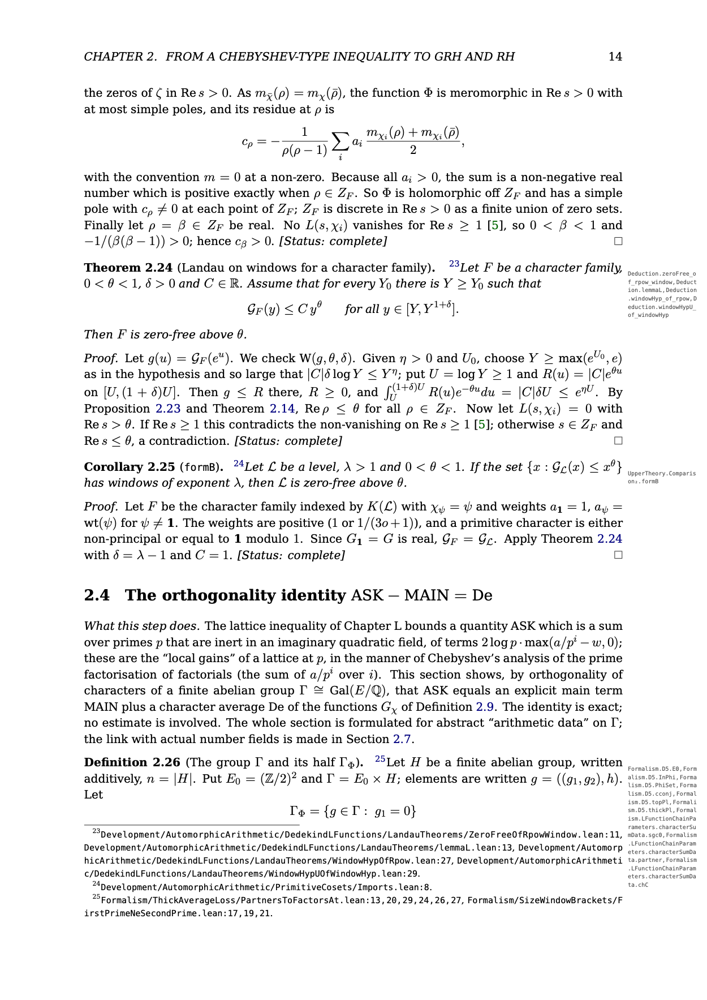

AI-written, AI cross-reviewed; no human sign-off; not a claim that RH is proved

# One-sided power windows and simple poles

**Starter for the analytic track.** Atlas units [P022](../../units/P022.md) · [P023](../../units/P023.md). The local reading target is `Deduction.landau_window` (exact head). P022 states the window lemma. P023 applies it to a positive character family.

**Background.** Complex analysis through residues, holomorphic power series, Mellin/Laplace transforms, and elementary bounds for the von Mangoldt function.

**Reading target.** Follow the abstract Landau implication for given pole data and a moving upper window. Identify where positivity at a real pole is needed and why the analytic radius forces a contradiction.

**Reading order.** Start at the definitions of PoleData and WindowHypU. Follow the Taylor coefficient inequality, the real/nonreal pole alternatives and the nearest-pole argument. Only then pass to the positive character family.

**Scope and prerequisites.** The local theorem assumes exactly the displayed pole and window hypotheses. The chapter derives the contradiction under them. The arithmetic supply of such windows, the explicit formula for an actual family, and global zero-freeness are separate tasks.

**Edition.** Blueprint v13, §§2.2–2.3, printed pp. 7–14 (8 actual pages; PDF pages 32–39). The page images preserve the typeset formulas. On a shared boundary page, adjoining material may be visible; the TeX selection below marks the exact span.

[Original local TeX excerpt](excerpt.tex) · [Edition register](../../data/editions.json)

Original PDF SHA-256 `d9dcb73f10a5829865f9246409d886c16cb1d2087717adf7758f154257a28af4`.

**Pinned Lean source.** `Development/AutomorphicArithmetic/DedekindLFunctions/LandauTheorems/landauWindow.lean:83–166`, range SHA-256 `104676d2ea110702c4c1586024ad2de75dc99d166c78548b85da61ba7d36c00d`. The [pin register](../../data/pins.json) records the graph and dominated line count.

- `blueprint/ch_E.tex:237–738`, selected source bytes SHA-256 `9a00ec6ae25e0439c5c78fd578135dea8523c3f3d94677dcf5921548f57109b4`.

## Typeset pages

## Status of literature-named inputs

- `Deduction.landau_window` — in-repo constant (`Development/AutomorphicArithmetic/DedekindLFunctions/LandauTheorems/landauWindow.lean:83–166`); not compared.
