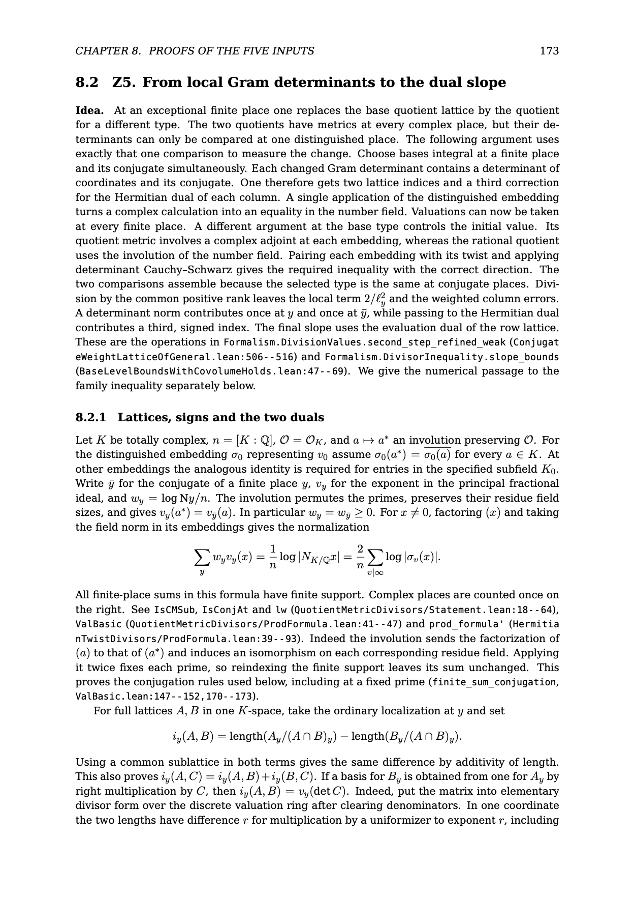
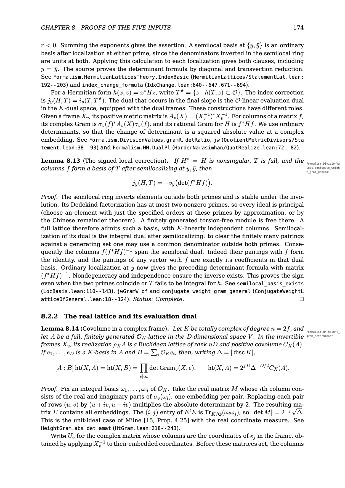
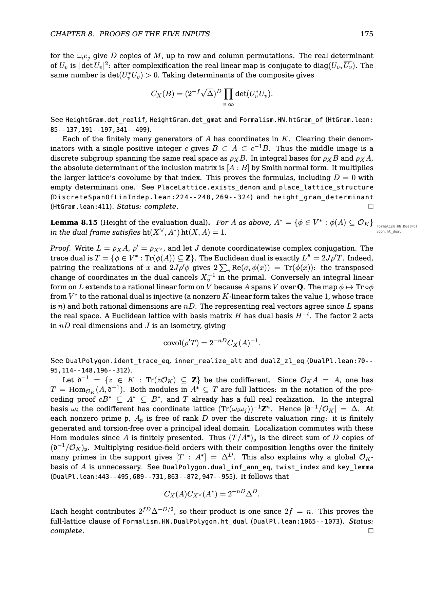
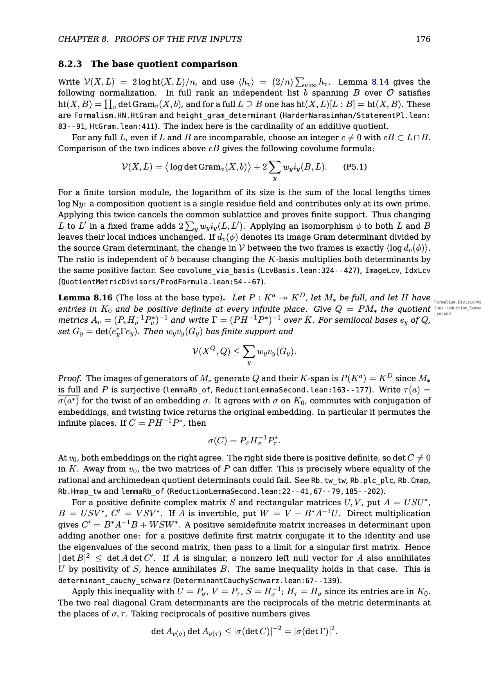
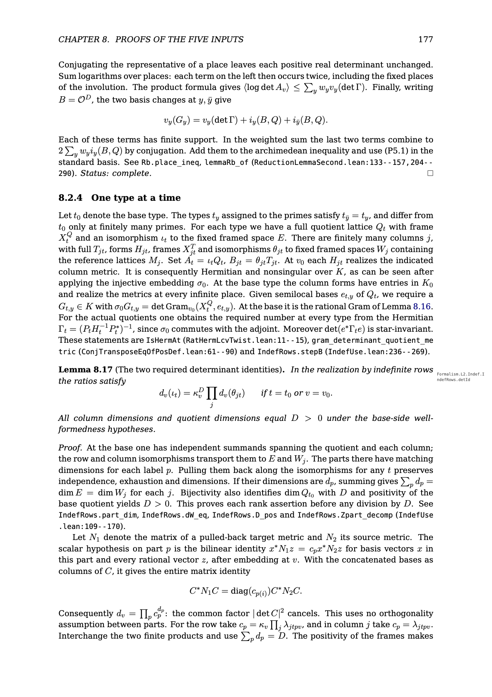
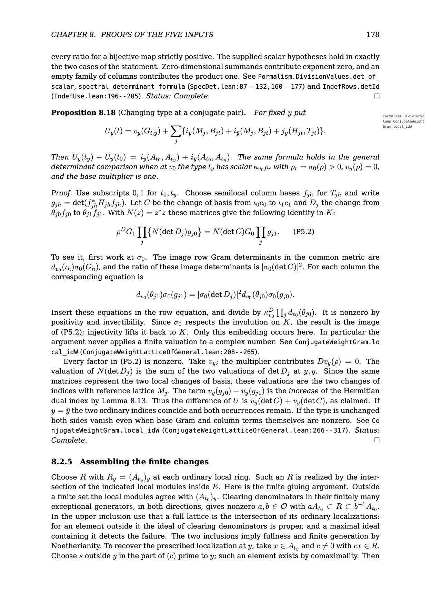

AI-written, AI cross-reviewed; no human sign-off; not a claim that RH is proved

# A Gram determinant in a complex frame

**Starter for the arakelov track.** Atlas units [P049](../../units/P049.md) · [Z5.1](../../units/Z5.1.md). The local reading target is `Formalism.HN.htGram_of` (supporting declaration). The fixed-frame Gram calculation is a tool in the height identity headed by Formalism.HN.height_gram_determinant (P049 and Z5.1).

**Background.** Linear algebra over a number field, its real Minkowski embedding, covolumes of lattices and the trace pairing.

**Reading target.** Calculate the covolume of a lattice with a chosen basis in its span. Identify the discriminant factor, the square of the complex determinant and the normalization that gives a height.

**Reading order.** Compare the two notions of dual in §8.2.1. In §8.2.2 track the determinant of the realification, then compare the archimedean product with the trace dual. §§8.2.3–4 explain what changes when the chart varies.

**Scope and prerequisites.** The fixed-frame calculation has an explicit full-rank basis in its span and invertible frames. These are the data of the theorem. The downstream bound for the actual family of rows needs the indicated project comparison records.

**Edition.** Blueprint v13, §§8.2.1–8.2.4, printed pp. 173–178 (6 actual pages; PDF pages 198–203). The page images preserve the typeset formulas. On a shared boundary page, adjoining material may be visible; the TeX selection below marks the exact span.

[Original local TeX excerpt](excerpt.tex) · [Edition register](../../data/editions.json)

Original PDF SHA-256 `d9dcb73f10a5829865f9246409d886c16cb1d2087717adf7758f154257a28af4`.

**Pinned Lean source.** `Formalism/HarderNarasimhan/HarderNarasimhanProofs/HtGram.lean:341–409`, range SHA-256 `d10c464cd5860b0ff2e24bf4e24ddf9a4dc9c6dbc2ad37e61974208fb6f32ebe`. The [pin register](../../data/pins.json) records the graph and dominated line count.

- `blueprint/ch_P.tex:1984–2417`, selected source bytes SHA-256 `a49a3be57cc00ab6f2f41b832a7f81059f1ff2bed6156c6502e5f6397cc34876`.

## Typeset pages

