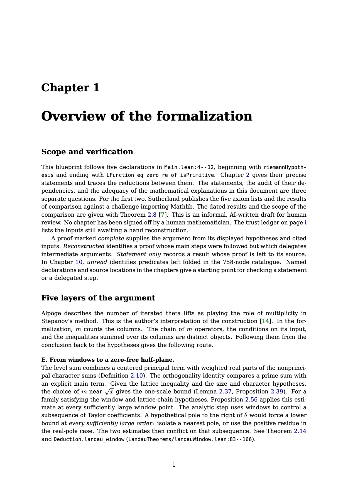
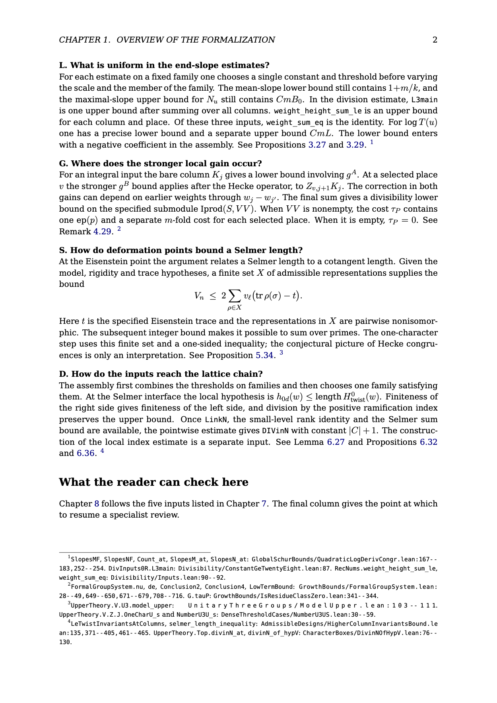
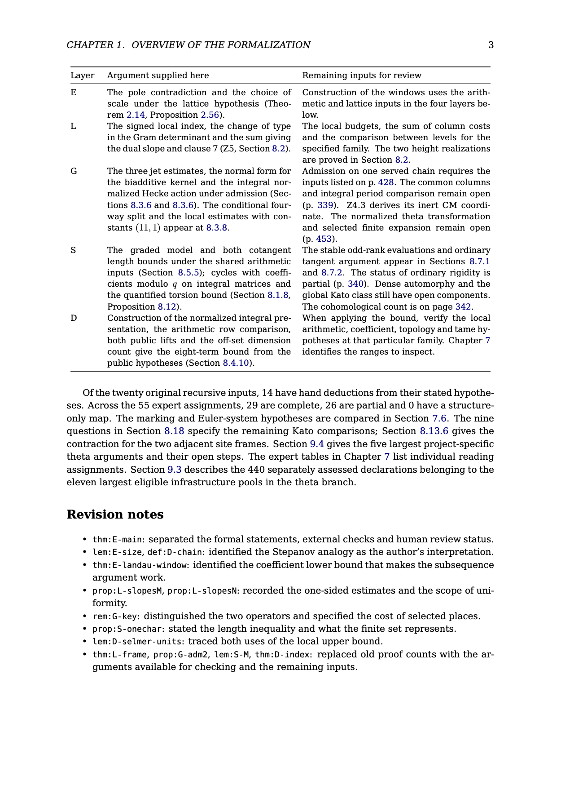
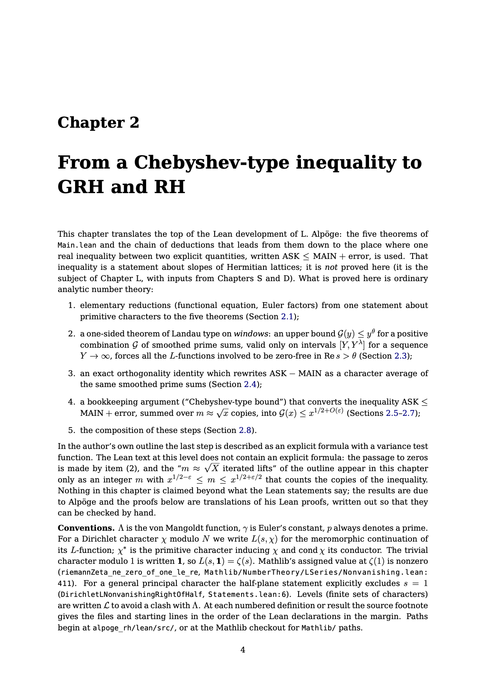
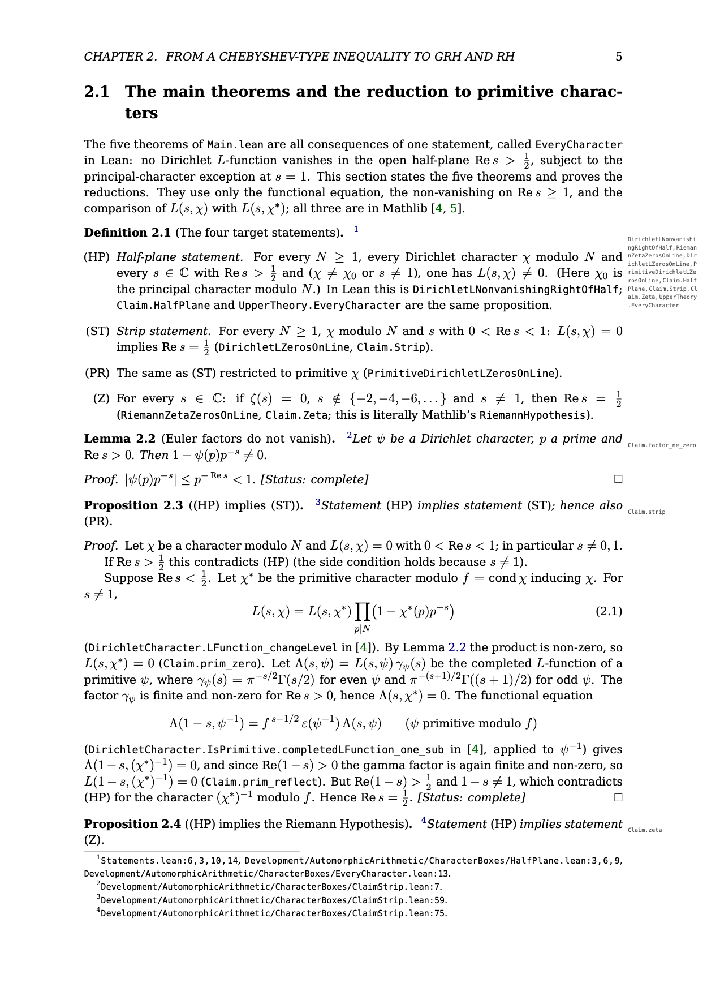
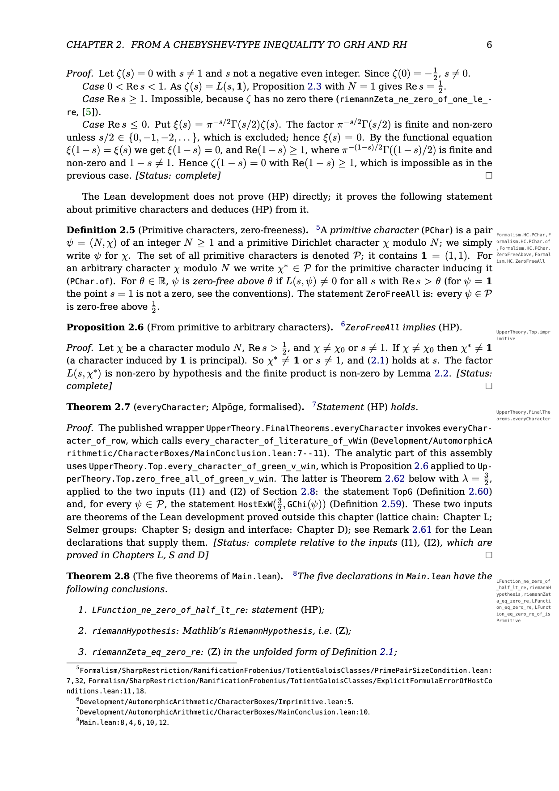
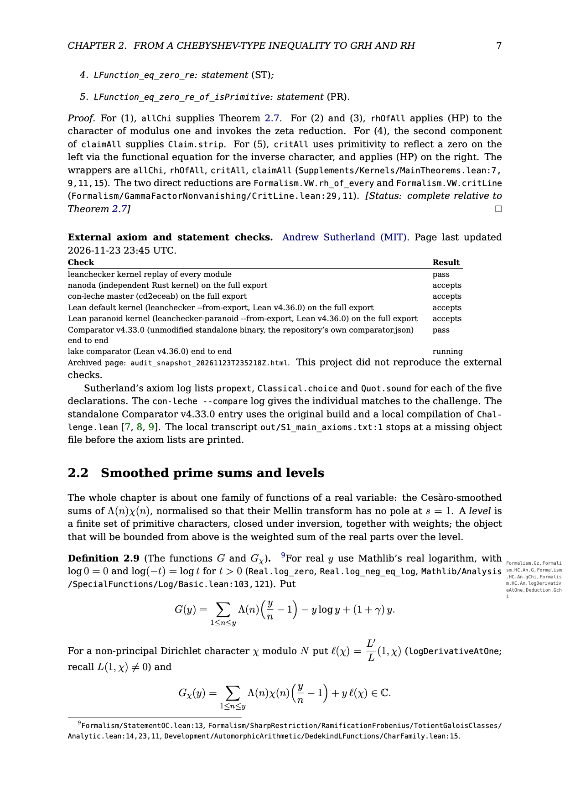

AI-written, AI cross-reviewed; no human sign-off; not a claim that RH is proved

# Audit one export and distinguish three verification questions

**Starter for the formal track.** Atlas units [P001](../../units/P001.md). The local reading target is `riemannHypothesis` (exact head). P001 is the public export inspected in this byte audit.

**Background.** Directory navigation, SHA-256, and the distinction between the type of a Lean declaration, its dependencies, and a compiled object. No mathematical background beyond the statement being inspected is required.

**Reading target.** Check the name and normalized range hash of one public export, then compare the exact scope of its statement with the dated evidence for replay and comparison.

**Reading order.** Read the chapter overview and the five declarations. Trace P001 to its single source line and use the local check below. Compare the recorded results for dependencies and proof exports with the source claim you have actually checked.

**Scope and prerequisites.** The byte comparison is fully repeatable from the fixed source checkout. A kernel replay and an independent mathematical proof are outside this exercise. The blueprint describes prior replay results, not a replay performed by the atlas.

**Edition.** Blueprint v13, Ch. 1 and §2.1, printed pp. 1–7 (7 actual pages; PDF pages 26–32). The page images preserve the typeset formulas. On a shared boundary page, adjoining material may be visible; the TeX selection below marks the exact span.

[TeX excerpt with portable source-root references](excerpt.tex) · [Edition register](../../data/editions.json)

Original PDF SHA-256 `d9dcb73f10a5829865f9246409d886c16cb1d2087717adf7758f154257a28af4`.

**Pinned Lean source.** `Main.lean:4–4`, range SHA-256 `71b3d50605ddda7c0c74fbbf5cca47165a4cfa2ad72f50f36b907ecac7ff505a`. The [pin register](../../data/pins.json) records the graph and dominated line count.

- `blueprint/ch_O.tex:1–133`, selected source bytes SHA-256 `3975f2747b3a03f1ae66bf0f38a63164db86e1f587b77eaefa535a89647f2efa`.
- `blueprint/ch_E.tex:1–236`, selected source bytes SHA-256 `ac99195e5a3a2aa67a19f12d0b60422e57c4cb2435d35bffa15c2e4973f6cbbc`.

The selected-source fingerprints above identify the original manuscript fragments. The distributed TeX uses `LEAN_SRC` for the local source root.

### Repeat the local export check

From the atlas root, with `LEAN_SRC` set as in the [procedures](procedures.md), run this read-only check. The hash excludes a final newline, matching the atlas range convention.

```python
import hashlib, json, os
from pathlib import Path

entry = json.loads(Path("data/pins.json").read_text())["anchors"]["riemannHypothesis"]
source = Path(os.environ["LEAN_SRC"]) / entry["file"]
lines = source.read_text().splitlines()[entry["line0"] - 1:entry["line1"]]
assert hashlib.sha256("\n".join(lines).encode()).hexdigest() == entry["sha256"]
print(entry["file"], entry["line0"], entry["line1"], *lines, sep="\n")
```

## Typeset pages















