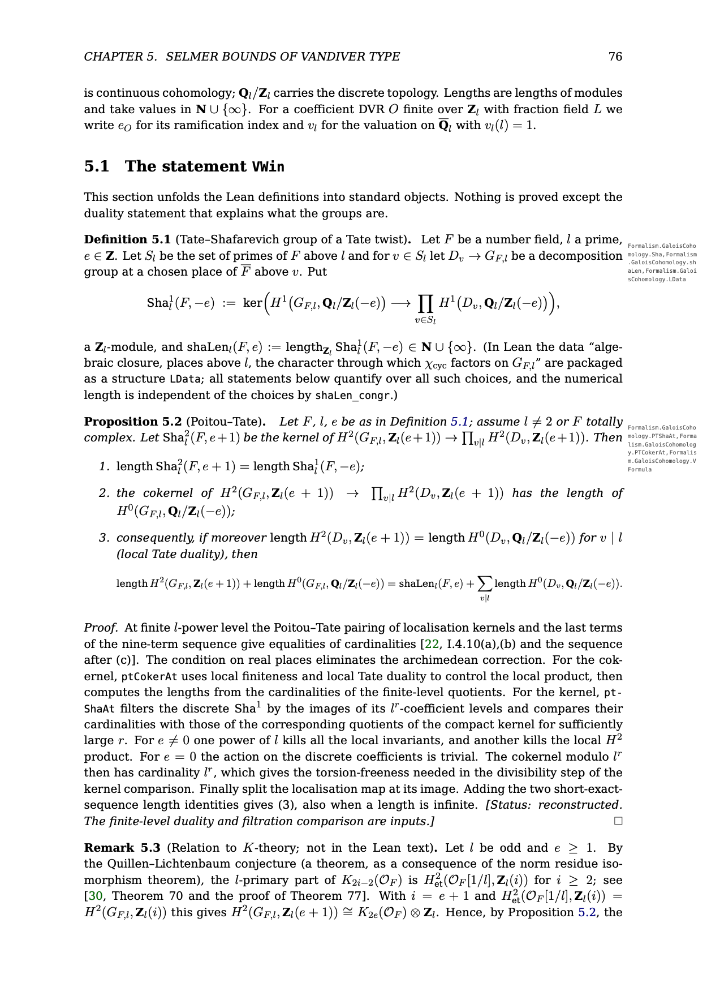
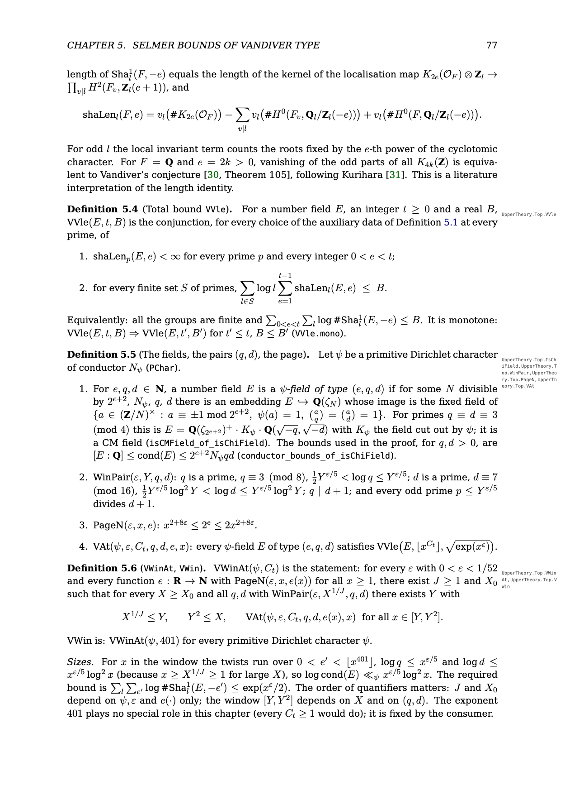
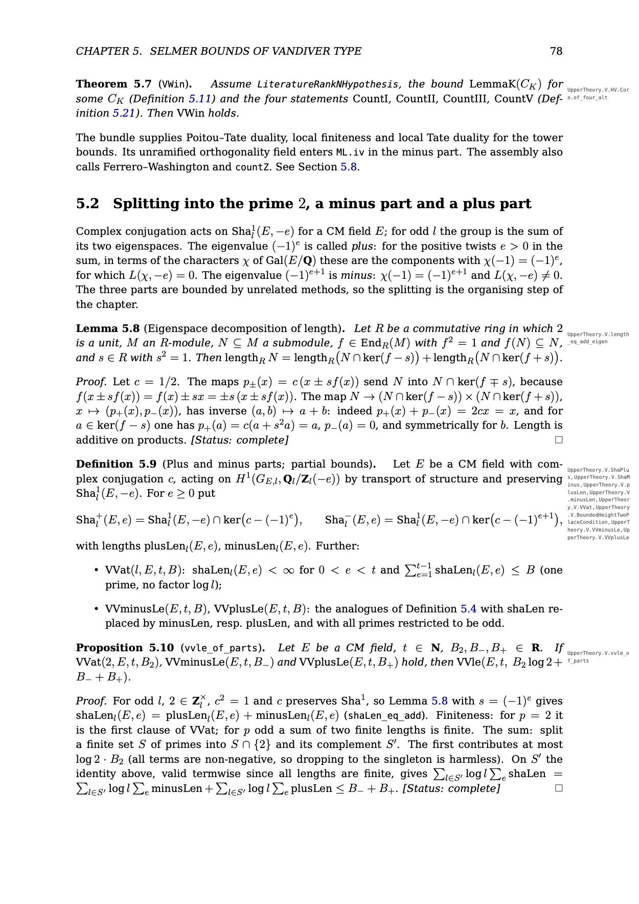
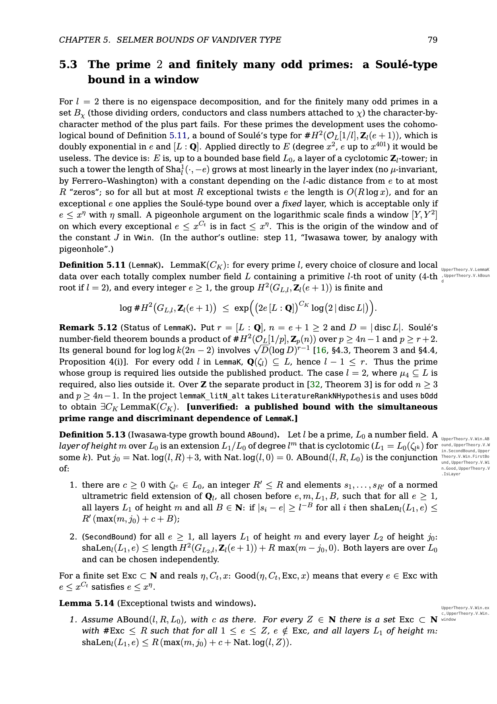
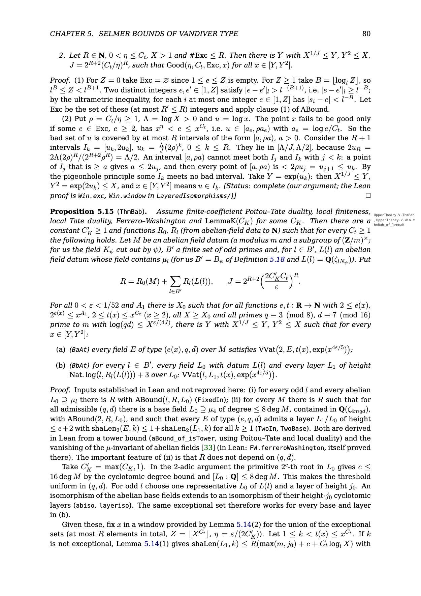
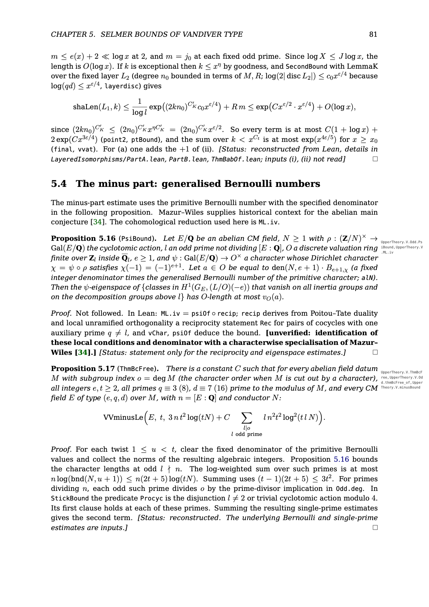

AI-written, AI cross-reviewed; no human sign-off; not a claim that RH is proved

# Recovering a full Selmer length from two eigenspaces

**Starter for the galois track.** Atlas units [P020](../../units/P020.md). The local reading target is `UpperTheory.V.vvle_of_parts` (supporting declaration). Proposition 5.10 recombines the two sign parts. P020 packages the five counting inputs and the window statement.

**Background.** Finite-length modules over a discrete valuation ring, involutions and their projectors. Cohomology is needed to recognize the localization kernel in the application.

**Reading target.** For odd primes, recover the two summands with the signs prescribed by the twist; account for the single factor log 2 when recombining the prime budgets.

**Reading order.** Read the finite-prime-set window statement, then the general involution lemma, the plus/minus convention and the weighted sum. The next section identifies the separate two-adic and tower inputs.

**Scope and prerequisites.** For the splitting argument the operator squares to the identity, the submodule is stable under it, and 2 is a unit. For the sum, finite bounds on the two parts and the two-adic part are explicit inputs. The packet does not derive a VWin or a uniform tower estimate.

**Edition.** Blueprint v13, §§5.1–5.3, printed pp. 76–81 (6 actual pages; PDF pages 101–106). The page images preserve the typeset formulas. On a shared boundary page, adjoining material may be visible; the TeX selection below marks the exact span.

[Original local TeX excerpt](excerpt.tex) · [Edition register](../../data/editions.json)

Original PDF SHA-256 `d9dcb73f10a5829865f9246409d886c16cb1d2087717adf7758f154257a28af4`.

**Pinned Lean source.** `Development/AutomorphicArithmetic/AutomorphicVarieties/LengthEqAddEigen.lean:127–189`, range SHA-256 `f1c9c55bd5efdf50a50637b4296ac6aef43822921ff2fa93b89bfd3ca1062e96`. The [pin register](../../data/pins.json) records the graph and dominated line count.

- `blueprint/ch_S.tex:50–392`, selected source bytes SHA-256 `5d9c447f9205093c4a964ab89e2273ec0ccc582174c33da1ec0c8812bb80e83e`.

## Typeset pages

