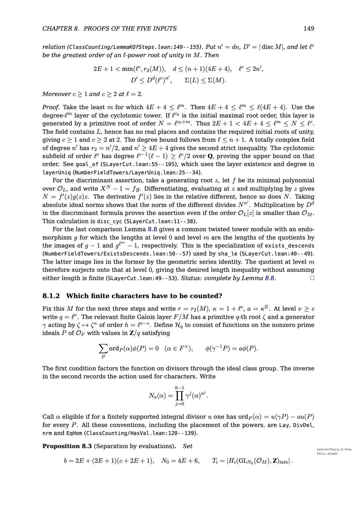
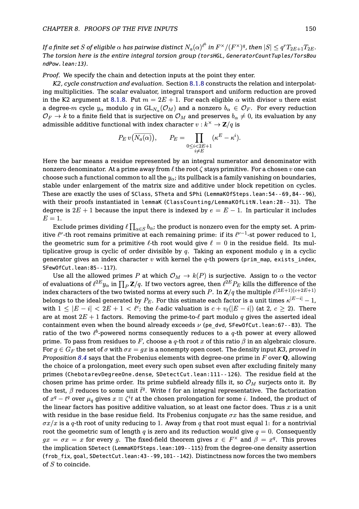
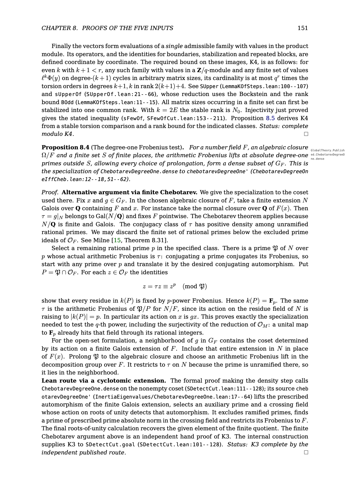
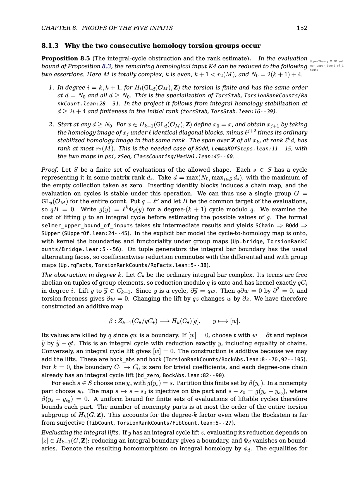
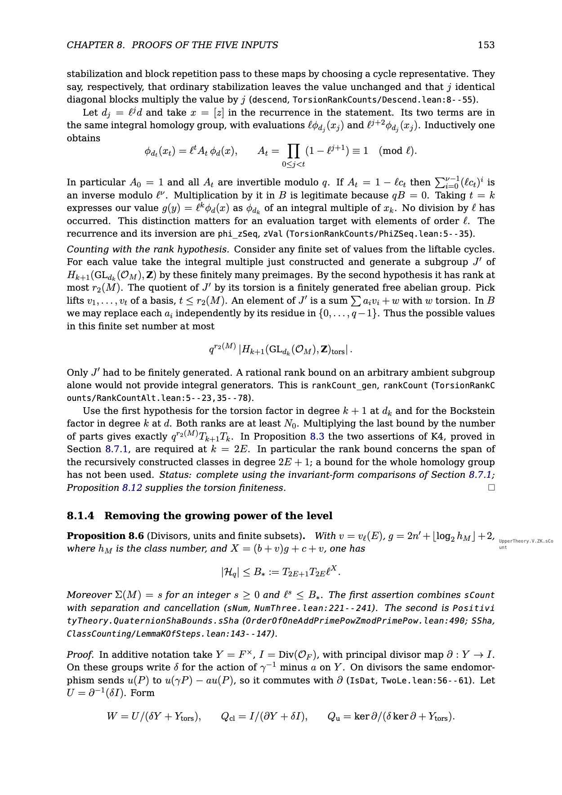
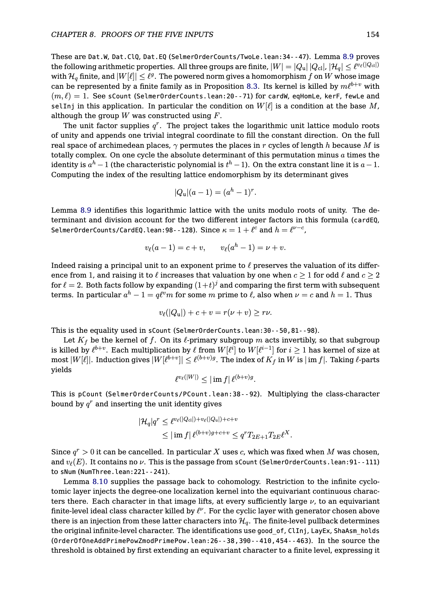
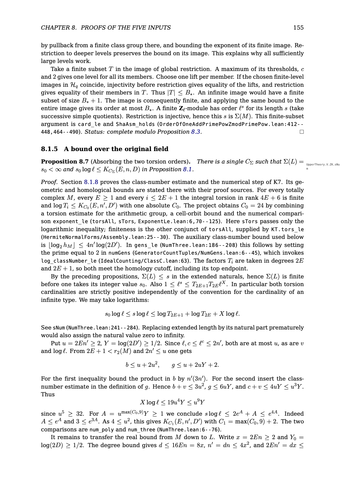

AI-written, AI cross-reviewed; no human sign-off; not a claim that RH is proved

# Finite divisor counts and the loss in the exponent

**Starter for the ktheory track.** Atlas units [P036](../../units/P036.md) · [Z2.K5](../../units/Z2.K5.md). The local reading target is `UpperTheory.V.ZK.sCount` (exact head). P036 and Z2.K5 share the formal head sCount. The elementary last step assumes the numerical cap derived from the arithmetic inputs.

**Background.** Finite abelian groups and their primary parts, valuations, units and ideal classes. The Selmer application also uses cohomology and congruence-group homology.

**Reading target.** Track the finite-subset count after evaluation separates the characters. Locate the class-number term, the exponent loss, and both consecutive homological torsion orders.

**Reading order.** Read separation by evaluations in §8.1.2, identify the integral-cycle input in §8.1.3 and track the quotient of the divisor group in §8.1.4. Check why a bound for every finite subset bounds the cardinality of the image.

**Scope and prerequisites.** The final finite-subset implication is elementary with a stated finite cap. The arithmetic estimate for that cap uses the explicitly named separation and integral-cycle/homology statements. Those inputs are not closed by this excerpt; LemmaK and its global Selmer bound need more.

**Edition.** Blueprint v13, §§8.1.2–8.1.4, printed pp. 149–155 (7 actual pages; PDF pages 174–180). The page images preserve the typeset formulas. On a shared boundary page, adjoining material may be visible; the TeX selection below marks the exact span.

[Original local TeX excerpt](excerpt.tex) · [Edition register](../../data/editions.json)

Original PDF SHA-256 `d9dcb73f10a5829865f9246409d886c16cb1d2087717adf7758f154257a28af4`.

**Pinned Lean source.** `Development/AutomorphicArithmetic/AutomorphicVarieties/ModularityArgument/ClassCounting/SelmerOrderCounts.lean:16–111`, range SHA-256 `b609ec60bcf992dfad3e6ecbfad1c5f1094e3a1a07756adf589676b08e0d22c2`. The [pin register](../../data/pins.json) records the graph and dominated line count.

- `blueprint/ch_P.tex:178–649`, selected source bytes SHA-256 `57ddd8e01ea15cd8d023852f6e4a030c795ecf6b6684df68977a6b38f46708a8`.

## Typeset pages

