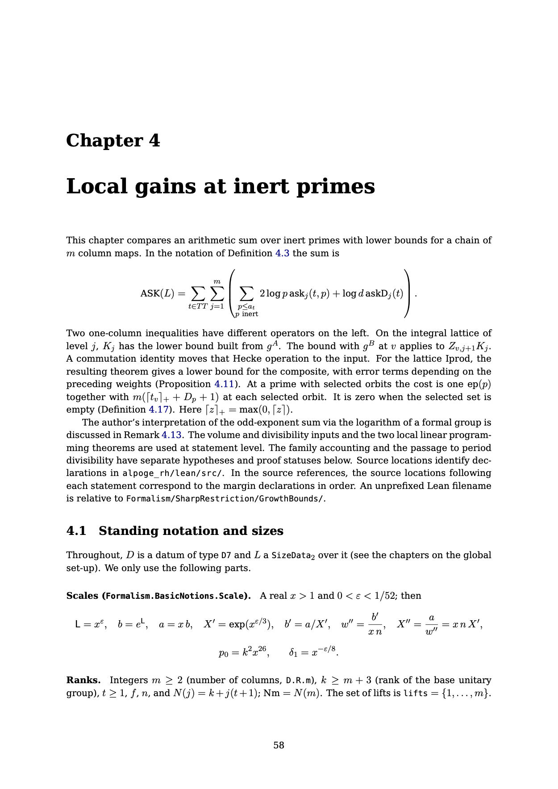
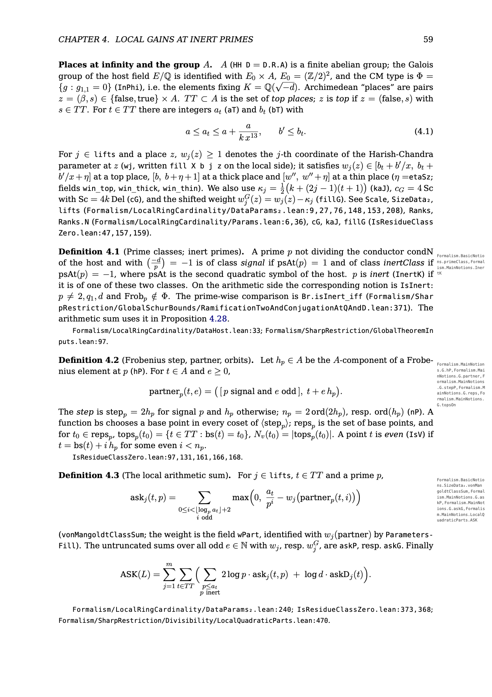
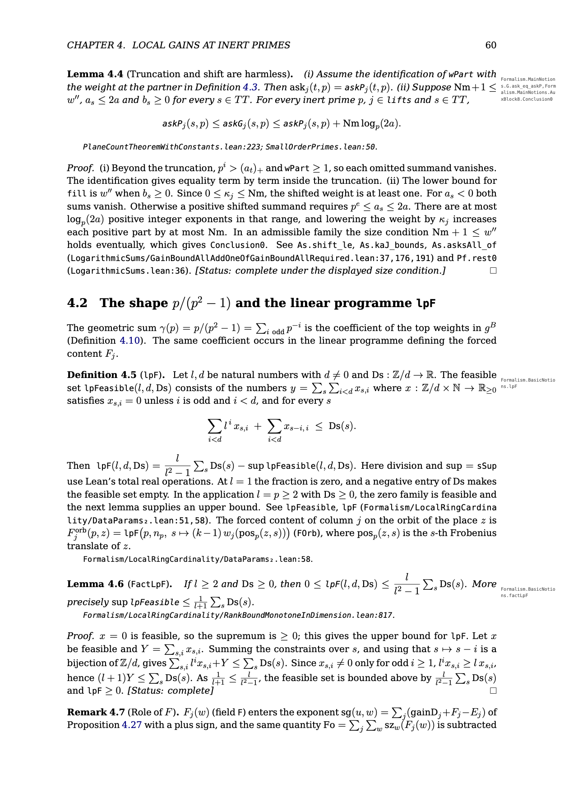
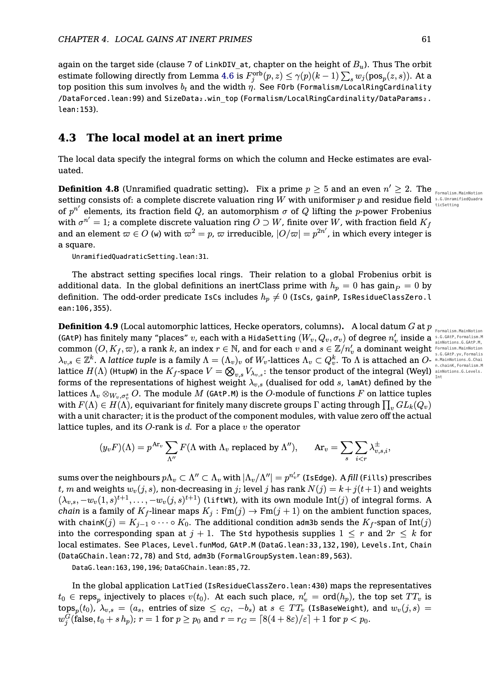
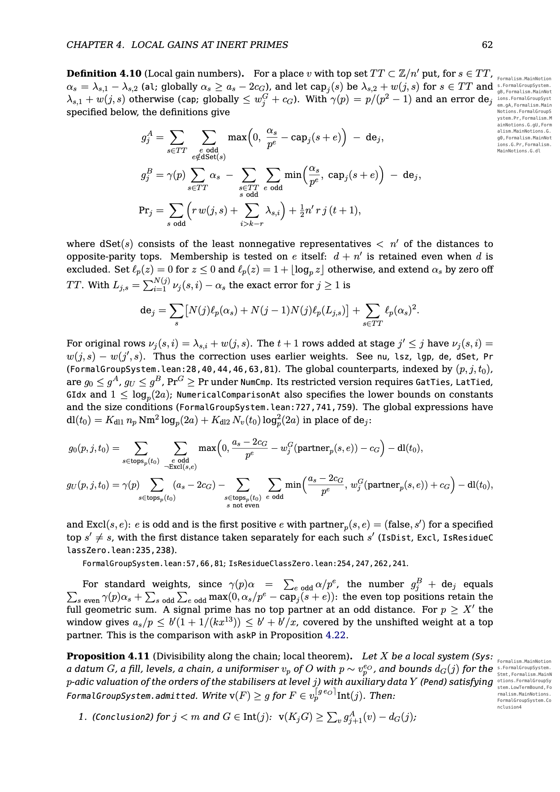
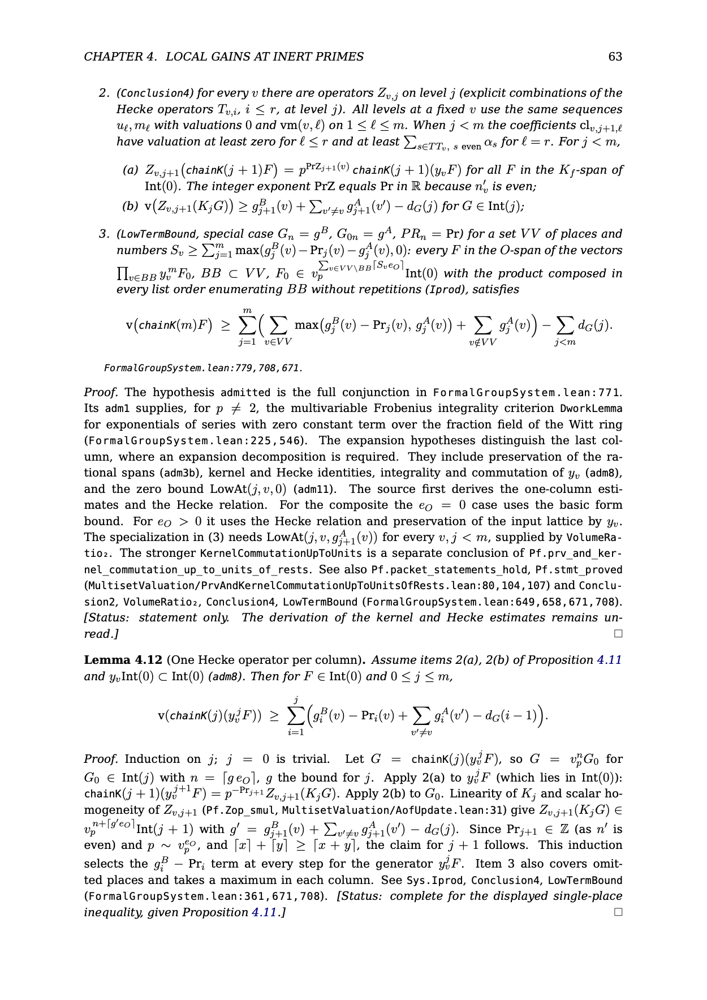
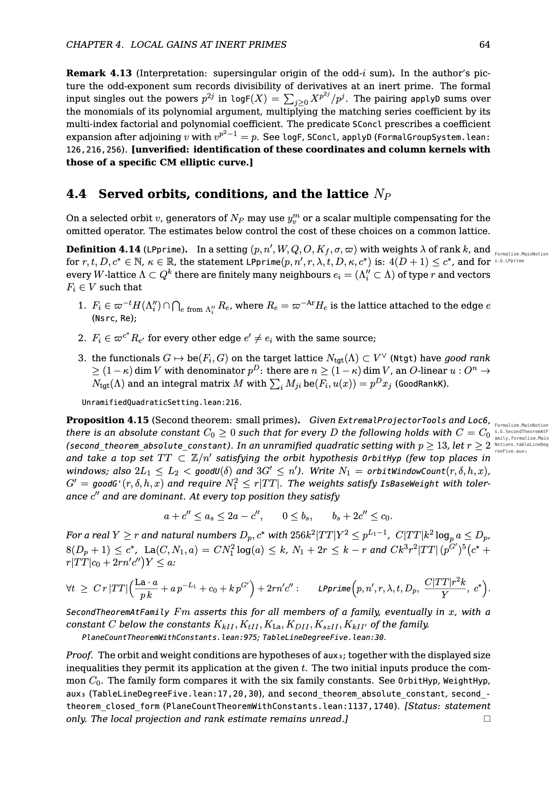

AI-written, AI cross-reviewed; no human sign-off; not a claim that RH is proved

# An elementary bound inside the inert-prime gain

**Starter for the local track.** Atlas units [P045](../../units/P045.md). The local reading target is `Formalism.BasicNotions.factLpF` (supporting declaration). Lemma 4.6 bounds the finite-array loss that appears in the inert-place estimate. P045 is the formal-group bound for weighted jets.

**Background.** Finite cyclic groups, finite sums, a supremum and the elementary notion of a valuation. Knowledge of formal groups is useful for the final application only.

**Reading target.** Verify the upper and lower bounds for the linear-programming defect lpF for a nonzero cycle length d, an integer parameter ℓ ≥ 2 and nonnegative row sizes Dₛ.

**Reading order.** Start with the orbit and column sizes, then isolate the feasible arrays of §4.2. Check the cyclic reindexing and the contribution of each allowed odd index. Read §4.3 for the local formal group in which the loss occurs.

**Scope and prerequisites.** The finite-array inequality is closed under the displayed numerical data. The application to weighted jets (P045) also needs the integral formal-group comparison and the local projection and rank conditions described on p. 64. This packet supplies background for P045 rather than a proof of its full statement.

**Edition.** Blueprint v13, §§4.1–4.3, printed pp. 58–64 (7 actual pages; PDF pages 83–89). The page images preserve the typeset formulas. On a shared boundary page, adjoining material may be visible; the TeX selection below marks the exact span.

[Original local TeX excerpt](excerpt.tex) · [Edition register](../../data/editions.json)

Original PDF SHA-256 `d9dcb73f10a5829865f9246409d886c16cb1d2087717adf7758f154257a28af4`.

**Pinned Lean source.** `Formalism/LocalRingCardinality/RankBoundMonotoneInDimension.lean:817–859`, range SHA-256 `040fbf2e7dbb8a0fae57ab7575d34326379f557d85cd87b82b3845b91ca58323`. The [pin register](../../data/pins.json) records the graph and dominated line count.

- `blueprint/ch_G.tex:25–359`, selected source bytes SHA-256 `854dcec6d5b4b5c9fc713266255d09fbfa7d71b7f7415a91d797a2868dc99714`.

## Typeset pages

