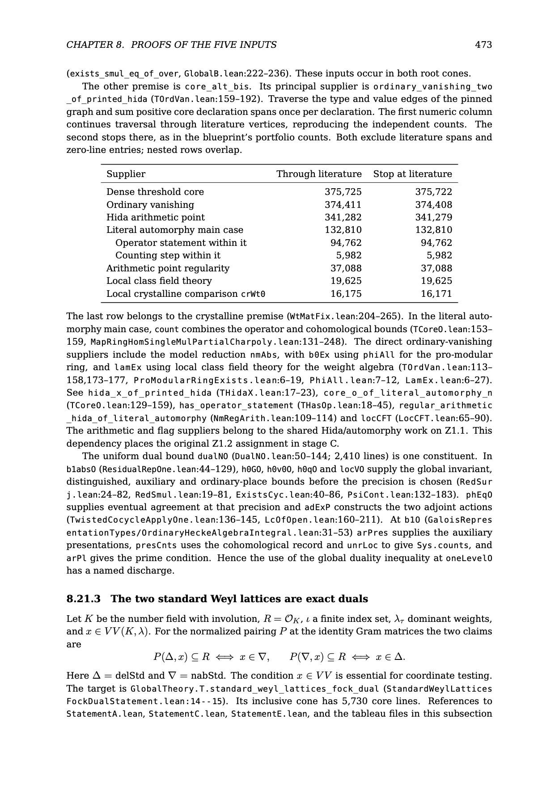
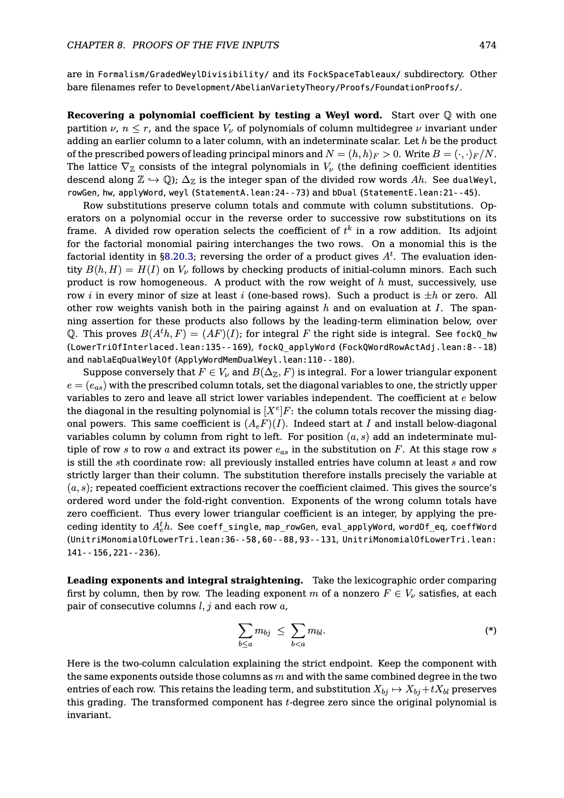
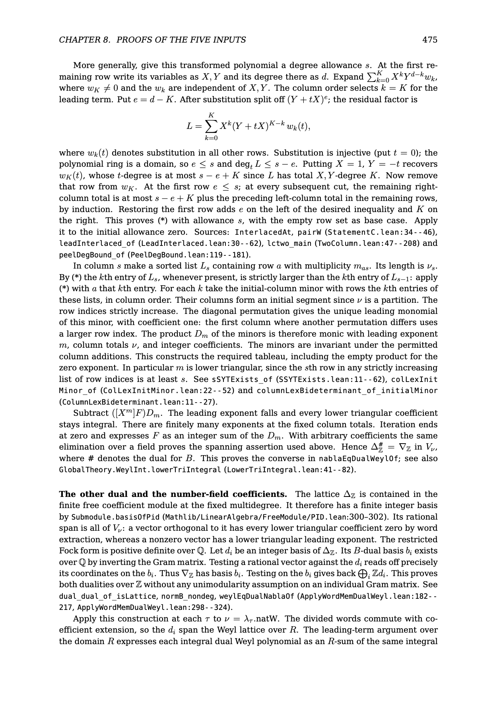
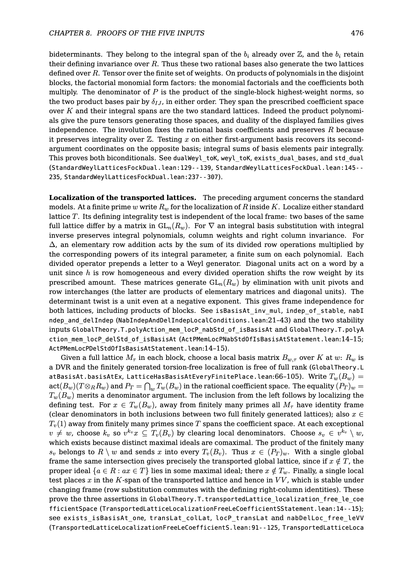
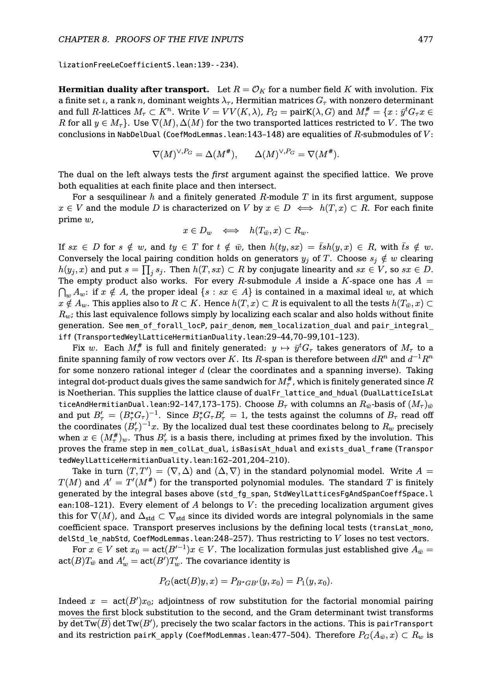
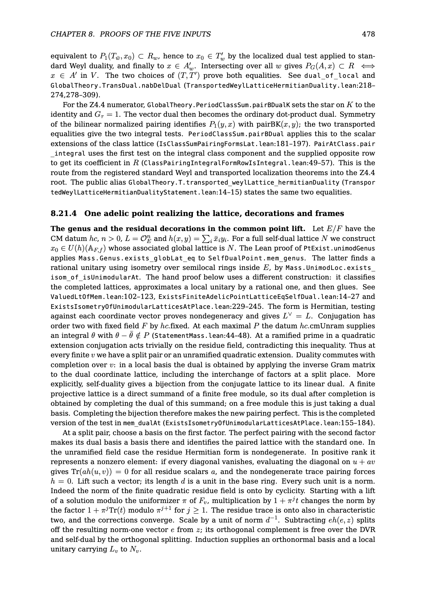

AI-written, AI cross-reviewed; no human sign-off; not a claim that RH is proved

# Testing the two integral Weyl lattices by Fock duality

**Starter for the theta track.** Atlas units [Z4.4](../../units/Z4.4.md). The local reading target is `GlobalTheory.T.standard_weyl_lattices_fock_dual` (supporting declaration). The standard-lattice theorem is one named input to the larger twisted-period argument in Z4.4.

**Background.** Integral lattices, polynomials, partitions and tableaux, factorial pairings and change of basis over a number field with involution.

**Reading target.** Check the two integrality tests for a vector in the specified Weyl space at the identity Gram matrix. The membership in that space is essential to the coefficient test.

**Reading order.** Begin with the normalized pairing and the two standard lattices. Follow how tests on Weyl words recover coefficients, then trace the triangular straightening and passage to integral coefficients. Finish with the limits of the transport argument.

**Scope and prerequisites.** The standard-lattice test is a local result with the normalized pairing, fixed dominant weights and a vector in the specified Weyl space. The surrounding Z4.4 theorem also needs a common site, transported lattices and period suppliers. The packet does not certify all of Z4.4.

**Edition.** Blueprint v13, §8.21.3, printed pp. 473–478 (6 actual pages; PDF pages 498–503). The page images preserve the typeset formulas. On a shared boundary page, adjoining material may be visible; the TeX selection below marks the exact span.

[Original local TeX excerpt](excerpt.tex) · [Edition register](../../data/editions.json)

Original PDF SHA-256 `d9dcb73f10a5829865f9246409d886c16cb1d2087717adf7758f154257a28af4`.

**Pinned Lean source.** `Development/AbelianVarietyTheory/Proofs/FoundationProofs/StandardWeylLatticesFockDualStatement.lean:14–15`, range SHA-256 `f8c587975fc79094055db20893e72a16aa4d9e10b91592c7ac34d2489b7ede35`. The [pin register](../../data/pins.json) records the graph and dominated line count.

- `blueprint/ch_P_r12.tex:224–585`, selected source bytes SHA-256 `91d711435b948412b18fd05e3fc465e84aeaa0a4f91713a52f8e066a0aa03f8a`.

## Typeset pages

